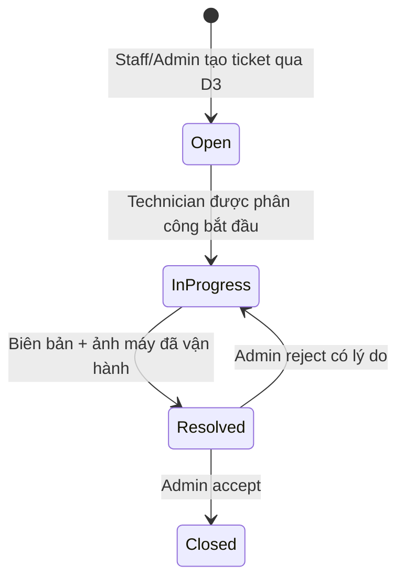

# MedEquipSLA — Nghiệp vụ Backend

Cập nhật 07/11/2026. Hệ thống quản lý thiết bị theo khoa, bảo trì/hiệu chuẩn, sửa chữa có ảnh nghiệm thu và SLA. Không quản lý bệnh nhân hoặc bệnh án. Đây là mô tả behavior đã triển khai; kết quả kiểm chứng và phần chưa triển khai được tách tại [tracker](development/BACKEND-COMPLETION-TRACKER.md).

Nguồn học phần: [PRN232 Final Assignment](assignment-compliance/PRN232%20-%20Final%20Assignment.pdf). Nguồn dự án: [C0](architecture/C0-System-Context.md), [C1](architecture/C1-Container.md), [BR v1.0 gốc](business/BUSINESS-RULES-v1.0-PROPOSED.md), [D1–D4](business/BUSINESS-RULES-D1-D4-APPROVED.md), [Identity/RBAC đã chốt](business/IDENTITY-RBAC-DECISIONS.md), [lifecycle bổ sung](business/BACKEND-LIFECYCLE-DECISIONS.md) và [R1–R4](development/WORKORDER-MODULE3-APPROVALS.md). Không tự xem mọi đề xuất trong bản BR gốc là Approved.

## Vai trò và phạm vi

| Vai trò | Hành vi |
|---|---|
| Admin | Quản lý nhân viên/khoa/danh mục/thiết bị, policy SLA, schedule, phân công, nghiệm thu, can thiệp D3 và retirement có kiểm soát |
| Technician | Đọc dữ liệu cần xử lý, chỉ ghi tiến độ/biên bản/ảnh trên công việc được phân công; không nghiệm thu thay Admin |
| DepartmentStaff | Xem thiết bị và tạo/xem Incident trong khoa hiện hành; không tự chọn khoa khác để vượt quyền |
| Mọi người dùng đã xác thực | Đọc/đánh dấu đã đọc thông báo cá nhân, quản lý preference kênh của mình |

Role trên wire là `DepartmentStaff`. Scope áp dụng trước count/filter/pagination/detail/export; snapshot khoa giữ lịch sử, không bị viết lại khi chuyển thiết bị. Chỉ ẩn nút trên FE không đủ. Mọi API owner kiểm phiên hiện hành qua Identity; lỗi phụ thuộc thì fail closed. Đổi role/khoa/access tăng AuthorizationVersion và revoke sessions. Outbox/Inbox gỡ phân công không còn đủ điều kiện, có version fence và sweep khắc phục event đến trước assignment commit. Không đổi status/SLA/lịch sử để gỡ người được giao.

## Tài khoản và xác thực

Operator tạo duy nhất một Admin bằng bootstrap có SQL application lock. Admin phải thiết lập TOTP trước khi có phiên quản trị; không có tài khoản/mật khẩu seed công khai. Luồng khôi phục Admin ngoài phạm vi theo quyết định chủ dự án.

Admin mời nhân viên hoặc import Excel: preview và lỗi từng dòng, partial success, không tạo trùng khi import lại. Lời mời hiệu lực 24h, chỉ dùng một lần; resend vô hiệu link cũ. PendingActivation khác explicit Admin-disabled: tài khoản bị đình chỉ lời mời không được activate/resend. Admin gỡ đình chỉ vẫn để Pending; cần lời mời mới để nhân viên tự đặt mật khẩu. Không kích hoạt bỏ qua trạng thái Inactive.

Nhân viên chọn MFA tùy chọn TOTP hoặc Email OTP; recovery codes chỉ hiển thị một lần và không replay. Admin không disable MFA thông thường. Password reset hiệu lực 30 phút, thu hồi các phiên; phản hồi không làm lộ email tồn tại. Password policy/lockout tăng mức, OTP/token được hash hoặc DataProtection bảo vệ. Access token 15 phút; refresh family có hạn cố định 7 ngày, rotate và phát hiện reuse. Logout một phiên không đăng xuất phiên khác; logout all tăng version và thu hồi toàn bộ. SignalR xác minh đúng query token, đóng session/connection bị thu hồi.

## Thiết bị

Admin tạo khoa, category và thiết bị với mã/serial duy nhất, danh mục đang Active. Sửa bằng RowVersion; chuyển khoa giữ history và phát Outbox, không đổi snapshot hồ sơ cũ. Department/Category có DELETE logical archive: IsActive=false, giữ row/FK/history và cấm liên kết mới. Đây là CRUD danh mục; không gọi Retire là thay cho DELETE mọi entity.

Ưu tiên trạng thái: **Retired > Broken > UnderMaintenance > Operational**. Incident chưa Closed tiếp tục Broken. WO InProgress/Completed là blocking, Scheduled chưa tự UnderMaintenance nhưng registration vẫn chặn Retire. WorkOrder/Schedule event không tự biến Broken thành Operational; chỉ Incident terminal proof hợp lệ mới giải quyết điều kiện Broken tương ứng. Event cũ/trùng không ghi đè SourceVersion mới hoặc hồi sinh Retired.

Admin Begin RetirementIntent → Equipment khóa đăng ký mới → source freeze admission/kiểm blocker → hai source Sealed đúng epoch → Admin Continue mới final Retired nếu Equipment không còn registration Pending/Active hoặc blocking projection. Begin/Continue chưa xác định trả 202, không trả thành công giả. Cancel intent giữ tombstone/epoch và chỉ mở source gate sau quyết định Equipment bền. Không tự Cancel WorkOrder, Abort source operation hay release để ép Retire. Timeout luôn chưa xác định.

## Incident và SLA

Admin cấu hình SLA theo priority/version. Ticket snapshot response/resolution duration/deadline lúc tạo; policy mới không đổi hồ sơ cũ. Deadline scanner ghi từng breach một lần cùng Outbox. Response tính lần tiếp nhận đầu; Resolution kết luận theo CompletedAtUtc của attempt cuối được Admin chấp nhận (D1), không lấy giờ nghiệm thu thay thế. Reject không reset SLA và không xóa ảnh/attempt cũ.

Biên bản sửa phải có kết quả, mô tả và ảnh PNG/JPEG tối đa 5 MB; API kiểm media signature và người được giao. Admin nghiệm thu hoặc trả lại với lý do. RelatedIncident chỉ liên kết thiết bị tương ứng, không hồi sinh Incident Closed; giữ lịch sử tái phát.

## Schedule, Occurrence và WorkOrder

Admin tạo schedule → persist Pending → Equipment xác nhận đăng ký → commit Schedule/Committed/Audit/Outbox cùng transaction local. Cùng Idempotency-Key/payload trả kết quả cũ; khác payload 409. Equipment timeout không tạo lịch thành công giả. API sửa/Inactivate cần RowVersion; kỳ đã lập giữ nguyên thời gian và reminder snapshot.

Scheduler lập kỳ trong Reminder Window, NextOccurrenceAtUtc tiến theo anchor/IntervalDays. Có catch-up và khóa cạnh tranh nhiều worker. **DueAtUtc = ScheduledOccurrenceAtUtc + CompletionWindowMinutes** theo D2 đã chốt, không cộng IntervalDays. DueSoon/Overdue unique theo occurrence/kind; ghi Reminder và Outbox cùng giao dịch. Kỳ cũ thiếu snapshot không suy đoán DueSoon, vẫn xét Overdue theo DueAtUtc đã lưu.

Chỉ khi đến kỳ, generator tạo durable D3 operation, đăng ký WorkOrder với Equipment, rồi commit WO + occurrence + operation + Audit + Outbox. Mỗi occurrence tối đa một WO. Retry sau timeout/restart dùng cùng operation/registration/payload; lease/fence chặn response cũ. Confirm RPC và event consumer idempotent. Pending/CancelRequested chưa rõ kết quả giữ blocker; từng retry/cancel/abort/unknown có Audit, quá budget cần Admin can thiệp.

WorkOrder: Scheduled → InProgress → Completed → Closed. Admin phân công; Technician đúng assignment bắt đầu/ghi tiến độ/nộp biên bản + ảnh. Calibration cần measurements/giới hạn và kết quả suy từ số đo. **Failed vẫn blocking**, không accept/Closed, trả lại InProgress để làm attempt mới. Reject giữ dữ liệu cũ; chỉ Passed được accept. Cancel trực tiếp chỉ Scheduled chưa bắt đầu và cần lý do.

Inactive dừng lập kỳ/WO mới, không xóa occurrence/WO hoặc release đăng ký. End schedule là kết thúc vĩnh viễn, hủy kỳ Planned chưa có WO, giữ lịch sử và không được reactivate. Registration chỉ release sau hết Pending và tất cả WO Closed/Cancelled. Admin hủy operation tạo Incident/Schedule chưa commit cần lý do/fence/Equipment abort tombstone; timeout chưa phải Aborted.

## Thông báo và báo cáo

Outbox nguồn → Redis Streams → Notification Inbox/record. Admin và Technician Active được chọn qua endpoint Identity chỉ đọc có service credential. Mỗi người chỉ xem thông báo của mình. Preference quyết định snapshot in-app/email cho event mới, không viết lại quyết định kênh cũ. SignalR chỉ gửi hint `notificationsChanged`; REST là nguồn bền khi reconnect.

SMTP ghi Sent sau ACK; lỗi tạm retry, lỗi vĩnh viễn giữ Failed, Admin retry có reason/RowVersion. Crash sau ACK trước SQL commit có thể gửi lại cùng Message-ID: at-least-once, không cam kết SMTP exactly-once. Kiểm thử dùng SMTP capture loopback, chưa gửi email ra ngoài.

Admin có báo cáo/CSV theo từng owner; không JOIN database service khác. Equipment là trạng thái hiện tại; Maintenance/Incident lọc theo snapshot khoa/thời điểm hồ sơ. Outcome SLA chỉ final khi Closed. Có giới hạn trang/HasNext và chống CSV formula injection.

## Phục hồi D3

[Snapshot/checkpoint](development/D3-SNAPSHOT-RECONCILIATION.md) định kỳ đối chiếu positive proof và các operation Unknown/Pending; giữ đăng ký nếu thiếu thông tin. Snapshot Completed nghĩa đọc đủ inventory, không đồng nghĩa hết blocker. Retire vẫn cần source gates Sealed dưới khóa admission.

Incident/Schedule Pending chưa có hồ sơ được tiếp tục bằng request gốc với phiên hiện hành, hoặc Admin controlled cancel; worker không mạo danh người dùng để tự commit create. WorkOrder worker có service-only protocol riêng và tự retry trong budget đã lưu. Không xóa dấu vết thất bại, không TTL release.

[API](API-DOCUMENTATION.md), [database](DATABASE-DOCUMENTATION.md), [runbook](development/BACKEND-RUNBOOK.md), [evidence](development/BACKEND-COMPLETION-TRACKER.md).
