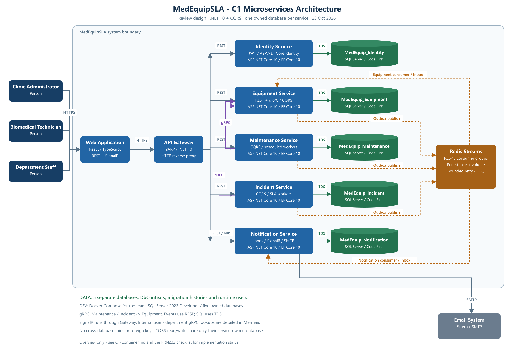
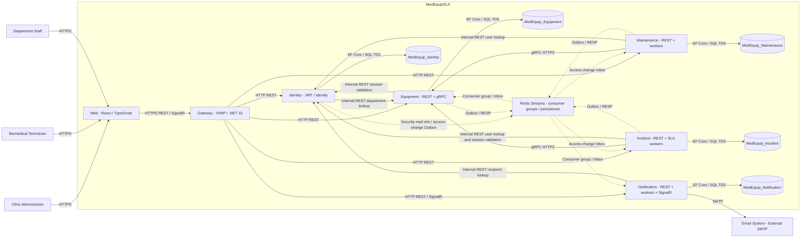

# C1 - Microservices Containers - MedEquipSLA

Ngày cập nhật: 07/11/2026. Giữ 5 owner boundaries; Backend implementation đang xác minh. [Tổng quan](../../README.md).

## Database ownership

| Service | Database sở hữu | Công nghệ |
|---|---|---|
| Identity | MedEquip_Identity | ASP.NET Core 10 / Identity / EF Core 10 Code First |
| Equipment | MedEquip_Equipment | ASP.NET Core 10 / REST + gRPC / EF Core 10 Code First |
| Maintenance & Calibration | MedEquip_Maintenance | ASP.NET Core 10 / workers / EF Core 10 Code First |
| Incident & SLA | MedEquip_Incident | ASP.NET Core 10 / workers / EF Core 10 Code First |
| Notification | MedEquip_Notification | ASP.NET Core 10 / SignalR / EF Core 10 Code First |

Tất cả là SQL Server databases riêng. Baseline nhóm dùng Docker Compose với SQL Server 2022 Developer; không phụ thuộc LocalDB cá nhân. Mỗi service có connection string, runtime user, DbContext và migrations riêng. Không truy cập database service khác. Gateway không có database nghiệp vụ.

## Mermaid source

Mermaid thể hiện các kết nối REST nội bộ và gRPC. PNG tóm tắt các luồng chính. Web mở kết nối SignalR qua Gateway để nhận thông báo.

## Architectural rules

- Gateway proxy HTTP; nghiệp vụ/CQRS nằm trong từng service. CQRS dùng cùng database cho đọc/ghi trong service.
- Equipment gRPC chạy độc lập với REST API gọi nó ở Maintenance/Incident; REST và gRPC của Equipment có thể host cùng process với endpoint riêng.
- Domain -> Outbox -> Redis Streams -> Inbox -> consumer data. ACK sau commit, bounded retry và dead-letter.
- Equipment sở hữu trạng thái thiết bị; event Incident/Maintenance cập nhật projection cục bộ có aggregate version.
- Notification lưu thông báo bền; SignalR chỉ báo có dữ liệu mới và REST phục hồi khi reconnect.
- Workers nằm trong service sở hữu dữ liệu ở cấu hình nhỏ; JWT và quyền database được kiểm tra tại từng service.

## Trạng thái scaffold và contract

Gateway, freshness, registration/fencing, source retirement coordination, workers và notifications đã có implementation/tests. Full acceptance và các giới hạn xem Backend tracker; không suy ra mọi cạnh/deployment đã PASS. [Compliance Matrix](../assignment-compliance/PRN232-CHECKLIST.md) và [review BR](../business/REVIEW-v1.0.md).

Equipment và Incident gọi trực tiếp REST của Identity để xác minh phiên theo BR-AUTH-12. Kết nối gRPC từ Incident và Maintenance đến Equipment dùng cho tra cứu thiết bị. Các lookup người dùng, khoa và người nhận theo C1 vẫn cần hoàn thiện theo từng luồng.

## Approved database design

[ERD v0.1 đã được duyệt](../database/ERD-REVIEW.md). Đã sinh/apply Code First migrations cho 5 database và kiểm chứng schema trên SQL Server LocalDB, compatibility 160; baseline Compose của nhóm vẫn là SQL Server 2022. Xem [database verification](../database/VERIFICATION.md). Các protocol/nghiệp vụ mô tả trong C1 vẫn cần được triển khai tại Application/Domain.

## Identity integration update

Identity Outbox gửi tham chiếu ticket (không gửi token/OTP thật qua Redis) tới Notification, và UserAccessChanged tới Incident/Maintenance Inbox. Source xác minh current technician eligibility qua REST Identity trước khi gỡ phân công; snapshot AuthorizationVersion và periodic sweep chống stale/reordered/racing assignment. Không đọc SQL database Identity trực tiếp. Notification render nội dung security mail qua endpoint chỉ đọc có service key ngay trước SMTP.
