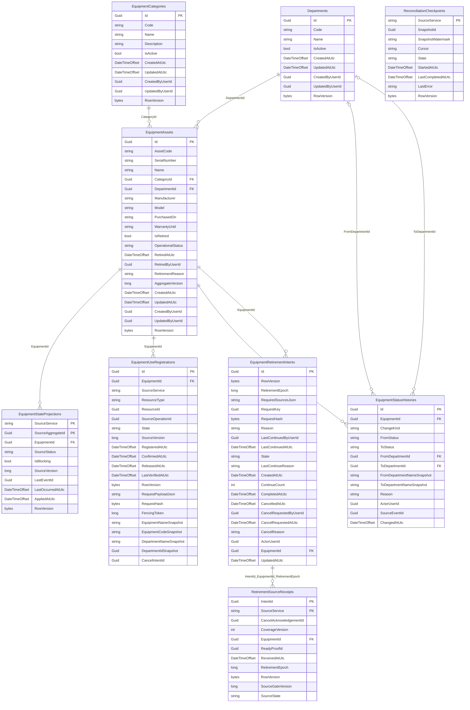

# MedEquip_Equipment — ERD v0.1 + Stage 2.1 foundation

**Schema Code First Stage 2.1 đã sinh và kiểm chứng trên catalog test; application DB vẫn ở InitialCreate.** [Tổng quan và quyết định D1–D4](../ERD-REVIEW.md); [kiểm chứng thực tế](../VERIFICATION.md). Use cases/workers còn chờ triển khai.

> PNG Equipment-ERD.png là snapshot v0.1 trước Stage 2.1. Mermaid bên dưới và Equipment.mmd phản ánh model mới; không dùng PNG cũ để kiểm schema.

## Quan hệ

## Data dictionary (SQL Server)

PK = primary key; FK = foreign key trong cùng database; UK = thành phần của một unique constraint/index (xem quy tắc); REF = ID ngoài database, không có FK. NULL cột nào được ghi rõ bên dưới. Diagram chỉ hiện các cột trọng tâm, dictionary là danh sách đầy đủ.

### Departments

Khoa/phòng nguồn, chỉ Equipment sở hữu.

| Cột | SQL type | Khóa | NULL | Ghi chú |
|---|---|---|---|---|
| Id | uniqueidentifier | PK | Không | — |
| Code | nvarchar(50) | UK | Không | — |
| Name | nvarchar(200) | — | Không | — |
| IsActive | bit | — | Không | — |
| CreatedAtUtc | datetimeoffset | — | Không | — |
| UpdatedAtUtc | datetimeoffset | — | Không | — |
| CreatedByUserId | uniqueidentifier | REF | Có | — |
| UpdatedByUserId | uniqueidentifier | REF | Có | — |
| RowVersion | rowversion | — | Không | — |

- Unique Code; không hard-delete nếu có thiết bị/tham chiếu lịch sử. Inactive chặn phân khoa/thiết bị mới.

### EquipmentCategories

Danh mục loại thiết bị.

| Cột | SQL type | Khóa | NULL | Ghi chú |
|---|---|---|---|---|
| Id | uniqueidentifier | PK | Không | — |
| Code | nvarchar(50) | UK | Không | — |
| Name | nvarchar(200) | — | Không | — |
| Description | nvarchar(2000) | — | Có | — |
| IsActive | bit | — | Không | — |
| CreatedAtUtc | datetimeoffset | — | Không | — |
| UpdatedAtUtc | datetimeoffset | — | Không | — |
| CreatedByUserId | uniqueidentifier | REF | Có | — |
| UpdatedByUserId | uniqueidentifier | REF | Có | — |
| RowVersion | rowversion | — | Không | — |

### EquipmentAssets

Thiết bị và trạng thái chính thức; chỉ service này được thay đổi.

| Cột | SQL type | Khóa | NULL | Ghi chú |
|---|---|---|---|---|
| Id | uniqueidentifier | PK | Không | — |
| AssetCode | nvarchar(50) | UK | Không | — |
| SerialNumber | nvarchar(100) | UK | Có | — |
| Name | nvarchar(200) | — | Không | — |
| CategoryId | uniqueidentifier | FK | Không | — |
| DepartmentId | uniqueidentifier | FK | Không | — |
| Manufacturer | nvarchar(200) | — | Có | — |
| Model | nvarchar(100) | — | Có | — |
| PurchasedOn | date | — | Có | — |
| WarrantyUntil | date | — | Có | — |
| IsRetired | bit | — | Không | — |
| OperationalStatus | nvarchar(30) | — | Không | — |
| RetiredAtUtc | datetimeoffset | — | Có | — |
| RetiredByUserId | uniqueidentifier | REF | Có | — |
| RetirementReason | nvarchar(2000) | — | Có | — |
| AggregateVersion | bigint | — | Không | — |
| CreatedAtUtc | datetimeoffset | — | Không | — |
| UpdatedAtUtc | datetimeoffset | — | Không | — |
| CreatedByUserId | uniqueidentifier | REF | Có | — |
| UpdatedByUserId | uniqueidentifier | REF | Có | — |
| RowVersion | rowversion | — | Không | — |

- Unique AssetCode; filtered unique SerialNumber khi khác NULL. Index(DepartmentId,OperationalStatus,Id).
- OperationalStatus ∈ Operational,UnderMaintenance,Broken,Retired; IsRetired phải khớp Retired (check).
- Version >= 1; Retired terminal; trạng thái tính bằng serialized local transaction, không cho client tự set.

### EquipmentStateProjections

Trạng thái các Incident/WorkOrder ảnh hưởng thiết bị, đồng bộ qua event.

| Cột | SQL type | Khóa | NULL | Ghi chú |
|---|---|---|---|---|
| SourceService | nvarchar(30) | PK | Không | — |
| SourceAggregateId | uniqueidentifier | PK,REF | Không | — |
| EquipmentId | uniqueidentifier | FK | Không | — |
| SourceStatus | nvarchar(30) | — | Không | — |
| IsBlocking | bit | — | Không | — |
| SourceVersion | bigint | — | Không | — |
| LastEventId | uniqueidentifier | — | Không | — |
| LastOccurredAtUtc | datetimeoffset | — | Không | — |
| AppliedAtUtc | datetimeoffset | — | Không | — |
| RowVersion | rowversion | — | Không | — |

- PK(SourceService,SourceAggregateId); index(EquipmentId,IsBlocking).
- SourceAggregateId là ID ngoài DB, không phải FK. SourceVersion tăng theo cùng aggregate, event cũ không ghi đè.

### EquipmentUseRegistrations

ĐỀ XUẤT D3: đăng ký sử dụng thiết bị bền để chặn race với Retire.

| Cột | SQL type | Khóa | NULL | Ghi chú |
|---|---|---|---|---|
| Id | uniqueidentifier | PK | Không | — |
| EquipmentId | uniqueidentifier | FK | Không | — |
| SourceService | nvarchar(30) | UK | Không | — |
| ResourceType | nvarchar(30) | UK | Không | — |
| ResourceId | uniqueidentifier | UK,REF | Không | — |
| SourceOperationId | uniqueidentifier | UK,REF | Không | — |
| State | nvarchar(20) | — | Không | — |
| SourceVersion | bigint | — | Không | — |
| RegisteredAtUtc | datetimeoffset | — | Không | — |
| ConfirmedAtUtc | datetimeoffset | — | Có | — |
| ReleasedAtUtc | datetimeoffset | — | Có | — |
| LastVerifiedAtUtc | datetimeoffset | — | Có | — |
| RowVersion | rowversion | — | Không | — |

- Unique(SourceService,ResourceType,ResourceId), unique(SourceService,SourceOperationId).
- State Pending/Active/Released/Aborted. Pending/Active chặn Retire; không tự release theo TTL.
- Register và Retire serialize trên cùng Equipment row; operation abort cần tombstone bền ở service nguồn.

### EquipmentStatusHistories

Lịch sử chuyển trạng thái, retire và chuyển khoa.

| Cột | SQL type | Khóa | NULL | Ghi chú |
|---|---|---|---|---|
| Id | uniqueidentifier | PK | Không | — |
| EquipmentId | uniqueidentifier | FK | Không | — |
| ChangeKind | nvarchar(30) | — | Không | — |
| FromStatus | nvarchar(30) | — | Có | — |
| ToStatus | nvarchar(30) | — | Có | — |
| FromDepartmentId | uniqueidentifier | FK | Có | — |
| ToDepartmentId | uniqueidentifier | FK | Có | — |
| FromDepartmentNameSnapshot | nvarchar(200) | — | Có | — |
| ToDepartmentNameSnapshot | nvarchar(200) | — | Có | — |
| Reason | nvarchar(2000) | — | Có | — |
| ActorUserId | uniqueidentifier | REF | Có | — |
| SourceEventId | uniqueidentifier | — | Có | — |
| ChangedAtUtc | datetimeoffset | — | Không | — |

- Index(EquipmentId,ChangedAtUtc,Id). SourceEventId filtered unique khi khác NULL.
- FK khoa là nội bộ Equipment; giữ snapshots để tên khoa lịch sử không đổi.

### ReconciliationCheckpoints

ĐỀ XUẤT D3: checkpoint đối soát service nguồn; không chứa dữ liệu nghiệp vụ dùng chung.

| Cột | SQL type | Khóa | NULL | Ghi chú |
|---|---|---|---|---|
| SourceService | nvarchar(30) | PK | Không | — |
| SnapshotId | uniqueidentifier | — | Có | — |
| SnapshotWatermark | nvarchar(256) | — | Có | — |
| Cursor | nvarchar(512) | — | Có | — |
| State | nvarchar(20) | — | Không | — |
| StartedAtUtc | datetimeoffset | — | Có | — |
| LastCompletedAtUtc | datetimeoffset | — | Có | — |
| LastError | nvarchar(2000) | — | Có | — |
| RowVersion | rowversion | — | Không | — |

- SourceService chỉ Incident/Maintenance. Không xóa blocking từ snapshot phân trang chưa hoàn tất.

## Bảng kỹ thuật thuộc database này

`AuditEntries`, `IdempotencyRequests`, `OutboxMessages`, `InboxMessages`. Đây là các bảng riêng trong MedEquip_Equipment, không dùng chung instance/table với service khác. [Định nghĩa bảng kỹ thuật](../TECHNICAL-TABLES.md).

## Stage 2.1 — schema/domain implemented, 06/11/2026

Migration: 20261106063402_AddEquipmentRetirementFoundation. Chỉ apply trên catalog test do harness quản lý; năm application DB chưa được upgrade. Chưa có RPC WO/retirement, Admin endpoint, source gate hoặc coordinator.

### EquipmentUseRegistrations — cột thêm

| Column | SQL type | Nullable | Note |
|---|---|---|---|
| RequestPayloadJson | nvarchar(max) | True | Legacy NULL/default0; no backfill |
| RequestHash | binary(32) | True | Legacy NULL/default0; no backfill |
| FencingToken | bigint | False | Legacy NULL/default0; no backfill |
| EquipmentNameSnapshot | nvarchar(200) | True | Legacy NULL/default0; no backfill |
| EquipmentCodeSnapshot | nvarchar(50) | True | Legacy NULL/default0; no backfill |
| DepartmentNameSnapshot | nvarchar(200) | True | Legacy NULL/default0; no backfill |
| DepartmentIdSnapshot | uniqueidentifier | True | Legacy NULL/default0; no backfill |
| CancelIntentId | uniqueidentifier | True | Legacy NULL/default0; no backfill |

### EquipmentRetirementIntents

| Column | SQL type | Key | Nullable |
|---|---|---|---|
| Id | uniqueidentifier | PK | False |
| RowVersion | rowversion |  | False |
| RetirementEpoch | bigint |  | False |
| RequiredSourcesJson | nvarchar(200) |  | False |
| RequestKey | uniqueidentifier |  | False |
| RequestHash | binary(32) |  | False |
| Reason | nvarchar(2000) |  | False |
| LastContinuedByUserId | uniqueidentifier | REF | True |
| LastContinuedAtUtc | datetimeoffset |  | True |
| State | nvarchar(20) |  | False |
| LastContinueReason | nvarchar(2000) |  | True |
| CreatedAtUtc | datetimeoffset |  | False |
| ContinueCount | int |  | False |
| CompletedAtUtc | datetimeoffset |  | True |
| CancelledAtUtc | datetimeoffset |  | True |
| CancelRequestedByUserId | uniqueidentifier | REF | True |
| CancelRequestedAtUtc | datetimeoffset |  | True |
| CancelReason | nvarchar(2000) |  | True |
| ActorUserId | uniqueidentifier | REF | False |
| EquipmentId | uniqueidentifier | FK | False |
| UpdatedAtUtc | datetimeoffset |  | False |

- Unique EquipmentId+RetirementEpoch; epoch allocated under Equipment row lock from complete retained history.

- Filtered unique EquipmentId where State <> Cancelled AND State <> Completed.

- Required sources are Maintenance v1 (WO+Schedule) and Incident v1; missing proof is not ready.

- No TTL. Only Application-internal verified eligibility can finalize domain retirement; no public Retire method.

### RetirementSourceReceipts

| Column | SQL type | Key | Nullable |
|---|---|---|---|
| IntentId | uniqueidentifier | PK | False |
| SourceService | nvarchar(30) | PK | False |
| CancelAcknowledgementId | uniqueidentifier |  | True |
| CoverageVersion | int |  | False |
| EquipmentId | uniqueidentifier | FK | False |
| ReadyProofId | uniqueidentifier |  | True |
| ReceivedAtUtc | datetimeoffset |  | False |
| RetirementEpoch | bigint |  | False |
| RowVersion | rowversion |  | False |
| SourceGateVersion | bigint |  | False |
| SourceState | nvarchar(20) |  | False |

- PK IntentId+SourceService is stricter than source+intent+epoch+coverage uniqueness.

- Composite FK binds IntentId/EquipmentId/RetirementEpoch; NoAction. CoverageVersion=1.

- Frozen/Blocked/Sealed/CancelAck; proof presence checked; Sealed proof retained when CancelAck arrives.

- SQL RowVersion, immutable binding, stale/contradicting source reports rejected in domain.

New Down migration refuses any intent/receipt or registration protocol data, including terminal proofs/tombstones. InitialCreate is unchanged. Binary(32) storage pads short SQL literals: domain computes SHA-256 itself; column width alone is not proof of a genuine hash. Audit ActorService factory is available without changing old Admin constructor. Retire history has no fabricated SourceEventId.
