# Maintenance Reminder — Phase 2, Module 2

Ngày thực hiện 05/11/2026. Phạm vi gồm Reminder DueSoon/Overdue, Outbox, Redis Streams và Notification Inbox.

## Audit trước triển khai

| Thành phần | Hiện trạng trước Module 2 |
|---|---|
| OccurrenceReminder | Có OccurrenceId, ReminderKind, EventId và TriggeredAtUtc; chưa có worker ghi |
| Ràng buộc Reminder | Unique (OccurrenceId,ReminderKind) và EventId đã có |
| ScheduleOccurrence | Có thời điểm kỳ và DueAtUtc; thiếu snapshot cửa sổ nhắc |
| Maintenance Outbox | Có lease, retry backoff, atomic claim và Redis publisher; dispatcher chỉ nhận thay đổi lịch |
| Notification Consumer | Nhận Incident SLA, XAUTOCLAIM, Inbox, XACK sau SQL commit và dead-letter |
| Recipient | Assignment ở WorkOrder.AssignedTechnicianId; lịch và occurrence không có người được phân công |
| Identity | Chưa có lookup người nhận cho background worker |
| Database | Cần một migration Maintenance cho snapshot nullable; Notification dùng schema hiện có |

Chủ dự án đã xác nhận hai quyết định trước khi code. Cho phép endpoint Identity chỉ đọc, bảo vệ bằng khóa service, phục vụ Module 2. Kỳ cũ không có snapshot bỏ qua DueSoon, ghi log và vẫn xét Overdue bằng DueAtUtc.

## Luồng đã triển khai

```mermaid
flowchart LR
    O[Occurrence và snapshot] --> R[ReminderPlanner kiểm tra thời điểm và lịch Active]
    R --> I[Identity lookup Admin và assigned Technician Active]
    I --> T[SQL local ghi Reminder cùng Outbox]
    T --> P[Dispatcher claim lease sau commit]
    P --> S[Redis reminder stream]
    S --> C[Notification Consumer và xác minh recipient]
    C --> N[SQL local ghi Notifications cùng Inbox]
    N --> A[XACK sau commit]
```



Reminder độc lập với việc WorkOrder đã tồn tại. Module này đọc assignment nếu có từ dữ liệu WorkOrder hiện hữu. Không tạo WorkOrder hoặc chuyển trạng thái occurrence sang WorkOrderCreated.

## Quy tắc thời gian và snapshot

- DueSoon đủ điều kiện khi ReminderWindowStartAtUtc <= now < ScheduledOccurrenceAtUtc.
- Tại ScheduledOccurrenceAtUtc hoặc sau đó, DueSoon bị bỏ qua.
- Khoảng ScheduledOccurrenceAtUtc <= now < DueAtUtc không tạo DueSoon hoặc Overdue mới.
- Overdue đủ điều kiện khi now >= DueAtUtc.
- Mỗi kỳ chỉ có một Reminder mỗi loại; DueSoon trước đó không ngăn một Overdue sau đó.
- Lịch Inactive không tạo Reminder mới. Reactivation xét thời điểm hiện tại cùng snapshot cũ.
- ScheduledOccurrenceAtUtc và DueAtUtc không đổi khi lịch được sửa.
- Công thức D2 giữ nguyên. DueAtUtc = ScheduledOccurrenceAtUtc + CompletionWindowMinutes.
- Snapshot ReminderWindowStartAtUtc ghi lúc lập kỳ, từ ScheduledOccurrenceAtUtc - ReminderLeadMinutes.
- Kỳ cũ NULL không được backfill bằng cấu hình lịch hiện tại. Chỉ xét Overdue cho kỳ đó.

Để tránh DueSoon lỗi thời sau lỗi mạng hoặc downtime, dispatcher giữ event Pending khi lịch Inactive và cửa sổ chưa qua, đặt lần thử kế tiếp sau một phút. Nếu đã đến thời điểm kỳ, dispatcher giữ lịch sử và chuyển Outbox sang Failed với LastError=DueSoonExpired. Event đã vào Redis nhưng bị xử lý muộn cũng chỉ ghi Inbox rồi ACK, không tạo Notification DueSoon lỗi thời. Overdue vẫn xét độc lập theo DueAtUtc.

## Recipient và quyền

Nguồn assignment là WorkOrder.AssignedTechnicianId. Kỳ chưa có WorkOrder hoặc chưa có assignment dùng Admin đang hoạt động. Có assignment thì thêm Technician đang hoạt động, đã kích hoạt và có mật khẩu. Không dùng người tạo lịch để suy ra kỹ thuật viên.

Identity cung cấp POST /api/internal/notification-recipients, body gồm technicianId có thể NULL. Header X-Recipient-Lookup-Key phải khớp Identity:RecipientLookupKey. Response chỉ gồm userIds; sai hoặc thiếu khóa trả 401.

Maintenance lưu danh sách recipient đã xác định trong payload. Notification xác minh lại trạng thái và role trước khi ghi, lấy giao giữa danh sách trong event và danh sách còn hợp lệ. Vì vậy tài khoản đã Inactive trước lúc consumer tra cứu không được tạo thông báo mới. Lỗi lookup giữ công việc để retry. Lookup rỗng ở nguồn không làm mất kỳ cần nhắc.

NotificationPreferences hiện có tiếp tục được tôn trọng. Inbox vẫn đánh dấu event đã xử lý nếu recipient đã Inactive hoặc người dùng đã tắt loại thông báo đó.

## Event contract và Redis

Sử dụng IntegrationEvent hiện có. Payload typed MaintenanceReminderEvent gồm ScheduleId, EquipmentId, EquipmentCode, EquipmentName, DepartmentId, ScheduledOccurrenceAtUtc, DueAtUtc, ReminderWindowStartAtUtc, ReminderKind, AssignedTechnicianId và RecipientUserIds.

| Thành phần | Giá trị |
|---|---|
| Event type | MaintenanceDueSoon hoặc MaintenanceOverdue |
| AggregateType / AggregateId | ScheduleOccurrence / OccurrenceId |
| Stream | medequip:maintenance:reminders:v1 |
| Consumer group | notification-maintenance-reminders-v1 |
| Dead-letter | medequip:maintenance:reminders:v1:dead-letter |
| Envelope | SchemaVersion=1, Producer=Maintenance; EventId ổn định |
| CorrelationId | EventId của yêu cầu nhắc |
| SLA stream và group | Giữ medequip:incident:sla:v1 và notification-sla-v1 |

## Giao dịch, retry và restart

Maintenance gọi Identity ngoài giao dịch SQL. Sau lookup, giao dịch khóa hàng Schedule và Occurrence, đọc lại Active, thời gian và assignment. Assignment đổi trong lúc lookup làm bỏ lượt để thử lại. Ghi Reminder và Outbox trong một giao dịch local. Unique key là lớp bảo vệ cuối khi nhiều scanner cùng chạy.

Publisher không nằm trong giao dịch nghiệp vụ. SQL lease claim từng event trước Redis XADD. Chỉ sau Redis xác nhận mới đánh dấu Published. Redis lỗi giữ Pending và backoff tối đa 300 giây. Retry giữ EventId. Publish thành công rồi process dừng trước cập nhật Published có thể tạo nhiều stream entry cùng EventId; Inbox và notification unique index xử lý trường hợp này.

Consumer lưu toàn bộ Notification của event cùng một Inbox marker trong SaveChanges transaction, sau đó mới ACK. Restart trước commit cho phép xử lý lại. Commit rồi mất ACK cho phép consumer mới claim và ACK mà không nhân đôi thông báo. XAUTOCLAIM dùng idle mặc định 30.000 ms. Mỗi vòng đọc tối đa 10 reclaimed và 10 fresh, log số lượng pending.

Payload sai được đưa dead-letter trước ACK. Lỗi xử lý tạm thời giữ pending. Sau 10 delivery, message được đưa dead-letter với lý do DeliveryLimit. Không nuốt lỗi hoặc ACK khi chỉ mới ghi một phần dữ liệu.

## Migration và schema

Migration Maintenance 20261105101458_AddOccurrenceReminderWindow thêm một cột datetimeoffset nullable vào ScheduleOccurrences. Không sửa InitialCreate. SQL idempotent được xuất tại docs/database/migrations/Maintenance.sql.

Up giữ NULL cho kỳ cũ. Down chỉ bỏ cột mới, giữ ScheduledOccurrenceAtUtc, DueAtUtc và dữ liệu Reminder/Outbox. Bộ test nâng từ InitialCreate, kiểm tra dữ liệu cũ, rollback riêng migration mới rồi apply lại.

ERD nguồn và data dictionary đã cập nhật tại docs/database/erd-model.json, docs/database/services/Maintenance.md và Maintenance.mmd. Notification không đổi schema. Các ảnh ERD v0.1 xuất trước Module 2 vẫn là ảnh lịch sử; schema hiện hành nằm ở Mermaid và JSON đã cập nhật.

## File chính

| File | Mục đích |
|---|---|
| Contracts.Events/MaintenanceReminderEvent.cs | Payload reminder và contract lookup recipient |
| Maintenance.Domain/ScheduleOccurrence.cs và MaintenanceSchedule.cs | Ghi snapshot tại thời điểm lập kỳ |
| Maintenance.Domain/OccurrenceReminder.cs | Tạo yêu cầu nhắc bền với EventId |
| Maintenance.Infrastructure/Persistence/ReminderPlanner.cs | Eligibility, lookup, kiểm tra lại và atomic write |
| Maintenance.Infrastructure/Workers/MaintenanceReminderWorker.cs | Tick bằng TimeProvider |
| Maintenance.Infrastructure/Workers/ScheduleOutboxDispatcher.cs | Publish reminder, giữ EventId, defer/expire DueSoon |
| Maintenance.Infrastructure/Messaging/ReminderRecipientLookup.cs | REST client nội bộ |
| Maintenance.Infrastructure/Persistence/Entities/OutboxMessage.cs | Hỗ trợ AggregateType ScheduleOccurrence |
| Maintenance.Infrastructure/Persistence/Configurations/ScheduleOccurrenceConfiguration.cs và Migrations | Mapping snapshot và migration EF Core |
| Notification.Infrastructure/Workers/NotificationConsumer.cs | Mở rộng consumer hiện tại cho reminder |
| Notification.Domain/NotificationRecord.cs | Nội dung thông báo bảo trì |
| Notification.Infrastructure/Messaging/ReminderRecipientLookup.cs | Xác minh recipient hiện hành |
| Identity.Api/NotificationRecipientEndpoints.cs và Program.cs | Lookup chỉ đọc được chủ dự án duyệt |
| DependencyInjection.cs của Maintenance/Notification | Đăng ký client, worker và TimeProvider |
| compose.yaml và .env.example | Khóa lookup nội bộ |
| tests/MedEquipSLA.Database.IntegrationTests/*Reminder*Tests.cs | Boundary, atomicity, rollback, duplicate và Redis thật |
| tests/check_backend_workflows.py | Regression HTTP và kiểm tra lookup recipient |

Đường dẫn service trong bảng tính từ src/Services. Contracts.Events tính từ src/Contracts/MedEquipSLA.Contracts.Events.

## Cấu hình và cách chạy test

Khóa mới là Identity__RecipientLookupKey tại Identity, Maintenance và Notification. Compose lấy từ NOTIFICATION_RECIPIENT_LOOKUP_KEY trong file .env local. Không commit giá trị thật. Identity__Address và ConnectionStrings__Redis dùng cấu hình hiện có.

Bật Workers__Enabled cho Maintenance và Notification để chạy đường nền. ConsumerClaimIdleMilliseconds chỉ cần giảm trong integration test; mặc định production/development là 30.000 ms.

Lệnh đã dùng từ solution root

```powershell
& ./.tools/dotnet/dotnet.exe build MedEquipSLA.sln --no-restore -c Release -m:4 --nologo -v:q
$env:SQLSERVER_TEST_CONNECTION='Server=(localdb)\MSSQLLocalDB;Database=master;Integrated Security=True;Encrypt=True;TrustServerCertificate=True'
$env:REDIS_TEST_CONNECTION='127.0.0.1:16379,defaultDatabase=15,abortConnect=false,connectTimeout=2000'
& ./.tools/dotnet/dotnet.exe test tests/MedEquipSLA.Database.IntegrationTests --no-build -c Release --nologo
python -u tests/check_backend_workflows.py
```

Trên máy thực hiện, Python chạy bằng executable trong runtime đã cài. Redis 8.4.2 thật được chạy từ gói Alpine trong workspace .tools/redis-test qua WSL, bind 127.0.0.1, cổng 16379. Dữ liệu test dùng Redis database 15 và database SQL Server LocalDB riêng. Test từ chối dùng Redis database đã có các stream cùng tên để bảo vệ dữ liệu khác. Không dùng fake Redis.

Real connection-loss test dùng TCP proxy ngắt và phục hồi kết nối tới Redis thật. Restart test tạo consumer identity mới, reclaim PEL của consumer cũ. Ca crash sau SQL commit trước ACK được dựng bằng commit StoreReminderAsync rồi để entry chưa ACK cho consumer mới reclaim. Đây là mô phỏng đúng ranh giới commit/ACK, chưa phải kill hệ điều hành đúng một instruction.

## Kết quả kiểm thử đã thực thi

| Nhóm kiểm tra | Kết quả |
|---|---|
| Build Release | PASS, 0 lỗi, 0 cảnh báo |
| Reminder eligibility, snapshot, inactive/reactivation, SQL atomicity, concurrency và Outbox | PASS, 15 test cases |
| Notification Inbox, nhiều recipient, duplicate, rollback, delayed DueSoon và regression SLA storage | PASS, 4 test cases |
| Migration nâng cấp dữ liệu cũ, rollback và apply lại | PASS, 1 test case chuyên biệt |
| Redis thật, publish, consume, ACK, duplicate, reclaim, poison và connection recovery | PASS, 4 test cases |
| Toàn bộ Database Integration Tests | PASS, 61/61, 0 skipped |
| Scheduler Module 1 | PASS, 8 cases trong bộ regression |
| API Bước 1, Gateway, gRPC và reactivation | PASS, smoke test exit code 0 |
| Recipient lookup qua HTTP với khóa service, fallback Admin, assigned Technician và Inactive | PASS, smoke test |
| EF model/ERD, index, constraints, full rollback và reapply của 5 service | PASS, trong Database Integration Tests |
| Docker Compose toàn hệ thống | NOT TESTED, Docker Engine không kết nối được |
| Kill process tại một instruction chính xác giữa commit và ACK | NOT TESTED; đã kiểm tra ranh giới bằng Inbox commit và consumer mới reclaim pending |

Lần chạy regression đầu phát hiện SQL schema test còn cố định số migration Maintenance bằng 1. Đã cập nhật kỳ vọng thành InitialCreate cộng AddOccurrenceReminderWindow và chạy lại toàn bộ suite. Lần cuối 61/61 PASS.

Đã rà lại source sau implementation. Reminder và Outbox cùng transaction. Dispatcher chỉ Published sau Redis xác nhận. Consumer chỉ ACK sau Inbox commit hoặc sau khi đã lưu dead-letter. Snapshot mới ghi ở điểm lập kỳ. Các kỳ cũ không bị thay đổi thời điểm hoặc DueAtUtc. Event duplicate giữ nguyên notification theo unique index và Inbox.

## Phạm vi còn lại

WorkOrder Generation, WorkOrder Equipment Registration, D3 reconciliation, SMTP và SignalR thuộc các module tiếp theo. Docker Engine trên máy hiện chưa hoạt động; Redis thật đã được kiểm thử qua WSL. Docker Compose toàn hệ thống chưa được kiểm chứng trong Module 2.
