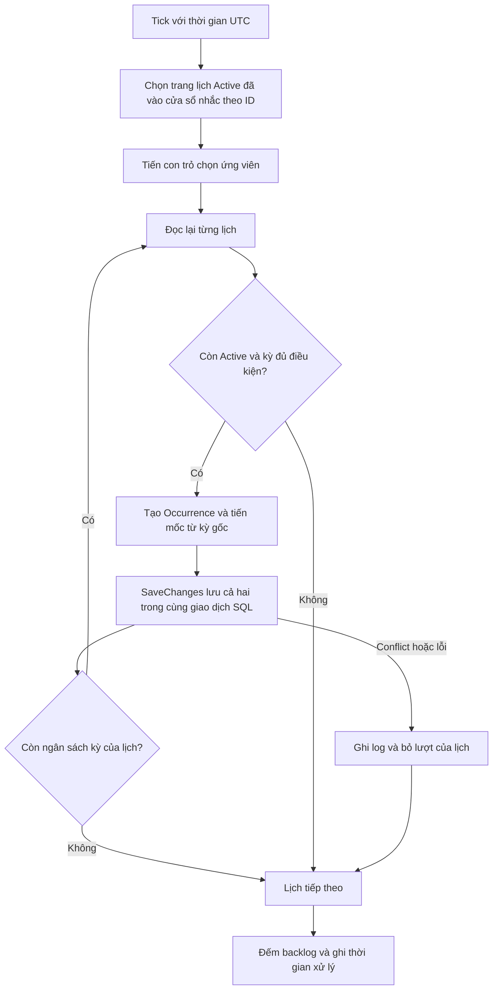

# Occurrence Scheduler — Phase 2, Module 1

Ngày thực hiện 05/11/2026. Maintenance sở hữu dữ liệu và tiến trình lập kỳ. Báo cáo này ghi nhận phạm vi lập kỳ, chạy bù, fairness, Inactive, reactivation và kiểm thử. Không có thay đổi schema hoặc migration.

## Audit và quyết định nghiệp vụ

Trước thay đổi, planner chọn 50 lịch cũ nhất và chỉ lập một kỳ mỗi lịch mỗi tick. Một nhóm lịch tồn nhiều kỳ có thể giữ các vị trí đầu. Concurrency và lỗi trùng bị bắt mà không ghi log. API kích hoạt lại giữ mốc cũ, dẫn đến lập bù kỳ chưa từng tồn tại trong khoảng Inactive.

Người dùng đã xác nhận giữ công thức D2. DueAtUtc = ScheduledOccurrenceAtUtc + CompletionWindowMinutes. IntervalDays xác định mốc kỳ kế tiếp. Các kỳ đã lập giữ nguyên thời gian, hạn và trạng thái Planned.

NextOccurrenceAtUtc luôn là kỳ tiếp theo chưa được lập. Reactivation tính mốc theo anchor và chu kỳ, lấy kỳ đầu tiên có thời điểm dự kiến lớn hơn hoặc bằng thời điểm kích hoạt lại. Nếu mốc hiện tại đã ở tương lai thì giữ mốc đó. Tại đúng ranh giới kỳ, kỳ đó được phép lập. Các kỳ Planned đã có vẫn tồn tại, kể cả khi thời điểm của chúng đã qua.

## File liên quan

| File | Thay đổi và lý do |
|---|---|
| Maintenance.Domain/MaintenanceSchedule.cs | Tính lại mốc khi chuyển Inactive sang Active, giữ lưới thời gian từ anchor và lịch sử cũ |
| Maintenance.Infrastructure/Persistence/ScheduleCommands.cs | Chuyển lỗi vượt phạm vi thời gian thành validation và kiểm tra mốc sau reactivation |
| Maintenance.Infrastructure/Persistence/OccurrencePlanner.cs | Phân trang theo ID, chạy bù có giới hạn, bắt lỗi theo lịch và ghi log có cấu trúc |
| Maintenance.Infrastructure/Persistence/OccurrencePlanningOptions.cs | Giới hạn lịch mỗi tick và kỳ mỗi lịch |
| Maintenance.Infrastructure/Persistence/OccurrencePlanningCursor.cs | Con trỏ chọn ứng viên dùng chung giữa các DI scope trong một process |
| Maintenance.Infrastructure/Workers/MaintenanceScheduler.cs | Dùng TimeProvider cho thời gian UTC và timer |
| Maintenance.Infrastructure/DependencyInjection.cs | Đăng ký TimeProvider, con trỏ và options có kiểm tra khi khởi động |
| Maintenance.Api/appsettings.json | Cấu hình mặc định 50 lịch và 4 kỳ mỗi lịch |
| tests/MedEquipSLA.Database.IntegrationTests/OccurrencePlannerTests.cs | Cập nhật cách khởi tạo planner trong test hiện có |
| tests/MedEquipSLA.Database.IntegrationTests/OccurrencePlanningSafetyTests.cs | Test boundary, UTC, chạy bù, fairness, restart, inactive, reactivation, rollback, concurrency và unique index |
| tests/check_backend_workflows.py | Thêm kiểm tra API reactivation và bảo toàn kỳ cũ |

Đường dẫn source ở trên tính từ src/Services/Maintenance, trừ các đường dẫn bắt đầu bằng tests/.

## Luồng xử lý



Mỗi tick mặc định chọn tối đa 50 lịch, xử lý tối đa 4 kỳ mỗi lịch, tương đương tối đa 200 kỳ. Mỗi kỳ là một giao dịch ngắn riêng. Mức này giữ cỡ trang hiện tại và tăng khả năng chạy bù mà không mở một giao dịch lớn.

Con trỏ phân trang theo ID và quay về đầu khi hết ứng viên phía sau. Lịch lỗi vẫn được vượt qua ở lượt chọn tiếp theo. Query chỉ tải ID trong một trang và từng lịch đang xử lý. Count và min backlog chạy tại SQL Server.

Cấu hình dùng Workers:OccurrencePlanning:ScheduleBatchSize và Workers:OccurrencePlanning:OccurrencesPerSchedule. Biến môi trường tương ứng là Workers__OccurrencePlanning__ScheduleBatchSize và Workers__OccurrencePlanning__OccurrencesPerSchedule. Phạm vi cho phép là 1–100 lịch và 1–16 kỳ mỗi lịch. Cấu hình ngoài phạm vi bị từ chối khi host khởi động.

## Giao dịch, concurrency và restart

RowVersion trên MaintenanceSchedule bảo vệ trước worker khác hoặc Admin sửa/ngừng lịch. Unique index (ScheduleId, ScheduledOccurrenceAtUtc) là lớp bảo vệ cuối. EF Core SaveChanges lưu mốc lịch và Occurrence nguyên tử. Conflict ghi log và lịch được thử lại trong vòng quét sau. Lỗi bất thường ghi ScheduleId và exception, đồng thời các lịch khác tiếp tục chạy.

Nếu dừng trước commit, mốc và kỳ chưa thay đổi. Sau commit, mốc mới đã lưu cùng kỳ. Con trỏ chọn ứng viên không mang ý nghĩa hoàn thành nghiệp vụ. Sau restart, vòng chọn bắt đầu lại nhưng tiến độ nghiệp vụ đọc từ SQL Server. Restart liên tục trước khi hoàn tất một vòng có thể tăng thời gian chờ của các ID ở cuối vòng.

Ngừng lịch không xóa các kỳ Planned. Nếu Admin ngừng lịch sau lúc worker đọc, RowVersion làm giao dịch worker cũ thất bại. Nếu worker đã commit trước, kỳ vừa lập được giữ trong lịch sử.

## Logging và vận hành

Log có tick bắt đầu/kết thúc, số lịch được chọn, giới hạn, số kỳ tạo, số lịch còn đủ điều kiện lập kỳ, độ trễ của kỳ cũ nhất và thời gian xử lý. Từng kỳ có thời điểm gốc và độ trễ thực tế. Lịch chuyển Inactive giữa lúc chọn và đọc được ghi nhận. Conflict và lỗi có ScheduleId để điều tra.

BacklogScheduleCount tính các lịch Active còn kỳ đã vào cửa sổ lập. Lateness chỉ tính phần thời gian vượt quá thời điểm kỳ, nên kỳ được lập sớm trong cửa sổ nhắc có lateness bằng 0.

## Kiểm thử

Bộ test tập trung dùng SQL Server LocalDB thật. Các test tạo database riêng, apply migrations và cleanup sau khi chạy. Test UTC và reactivation tại ranh giới có đồng hồ đầu vào xác định. Test concurrency dùng hai DbContext. Test Admin ngừng lịch trong khi worker chờ lưu có điểm đồng bộ tại SaveChanges. Test lỗi trước commit dùng check constraint tạm thời trong database thử nghiệm.

Smoke test Bước 1 dùng Gateway, các API và gRPC thật. Ca timeout dùng endpoint thử nghiệm giữ kết nối mà không trả lời. Test reactivation gọi PUT thật và kiểm tra mốc tương lai cùng dữ liệu Occurrence cũ.

Lệnh build và test đã sử dụng từ solution root

```powershell
& ./.tools/dotnet/dotnet.exe build MedEquipSLA.sln --no-restore -c Release -m:4 --nologo -v:q
$env:SQLSERVER_TEST_CONNECTION='Server=(localdb)\MSSQLLocalDB;Database=master;Integrated Security=True;Encrypt=True;TrustServerCertificate=True'
& ./.tools/dotnet/dotnet.exe test tests/MedEquipSLA.Database.IntegrationTests --no-build -c Release --nologo --filter 'FullyQualifiedName~Occurrence'
& ./.tools/dotnet/dotnet.exe test tests/MedEquipSLA.Database.IntegrationTests --no-build -c Release --nologo
python -u tests/check_backend_workflows.py
```

Lần chạy smoke test thực tế dùng Python trong runtime cài trên máy. Python 3 trên PATH có thể dùng lệnh tương đương ở trên.

## Kết quả đã thực thi

| Kiểm tra | Kết quả |
|---|---|
| Build Release | PASS, 0 warning, 0 error |
| Nhóm test Occurrence trên SQL Server LocalDB | PASS, 8/8 |
| Toàn bộ Database Integration Tests | PASS, 37/37, 0 skipped |
| Tạo kỳ tại ranh giới, UTC, giữ lưới thời gian và DueAt theo D2 | PASS |
| Fairness 5 lịch với batch 2 và tối đa 2 kỳ mỗi lịch | PASS |
| Inactive, reactivation và giữ các kỳ Planned cũ | PASS |
| Hai planner đồng thời | PASS, test hiện có |
| Admin ngừng lịch đúng lúc worker chuẩn bị SaveChanges | PASS, RowVersion làm worker rollback |
| Lỗi ghi kỳ trước commit, xử lý tiếp lịch khác và restart thử lại | PASS |
| Unique index từ chối dữ liệu kỳ trùng | PASS |
| API Bước 1 qua Gateway/gRPC, gồm reactivation | PASS, smoke test kết thúc exit code 0 |
| Kiểm tra model, migrations và rollback database | PASS trong bộ Database Integration Tests |
| Kill process tại đúng thời điểm SQL commit đang diễn ra | NOT TESTED; đã kiểm tra rollback do lỗi SQL và restart bằng DbContext mới |
| Redis và Docker | NOT TESTED trong Module 1 |

Đã rà lại source sau implement. Planner chỉ tạo ScheduleOccurrence và cập nhật mốc lịch. DueAt tiếp tục tính theo CompletionWindowMinutes. Schema, unique index và RowVersion giữ nguyên. Các thay đổi tính reactivation được áp dụng tại chuyển Inactive sang Active và qua API PUT hiện có.

## Giới hạn phạm vi

Chưa triển khai Reminder, WorkOrder Generation, D3 reconciliation hoặc xử lý các kỳ Planned cũ ở module tiếp theo. Chưa kiểm thử Redis hay Docker trong Module 1. Không có yêu cầu Redis để lập kỳ. Module này bảo toàn dữ liệu kỳ cho các bước sau.

Không có migration. Không có thay đổi unique index hoặc RowVersion. Model/migration regression tests kiểm tra schema hiện tại.
