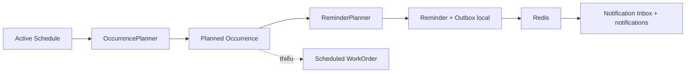
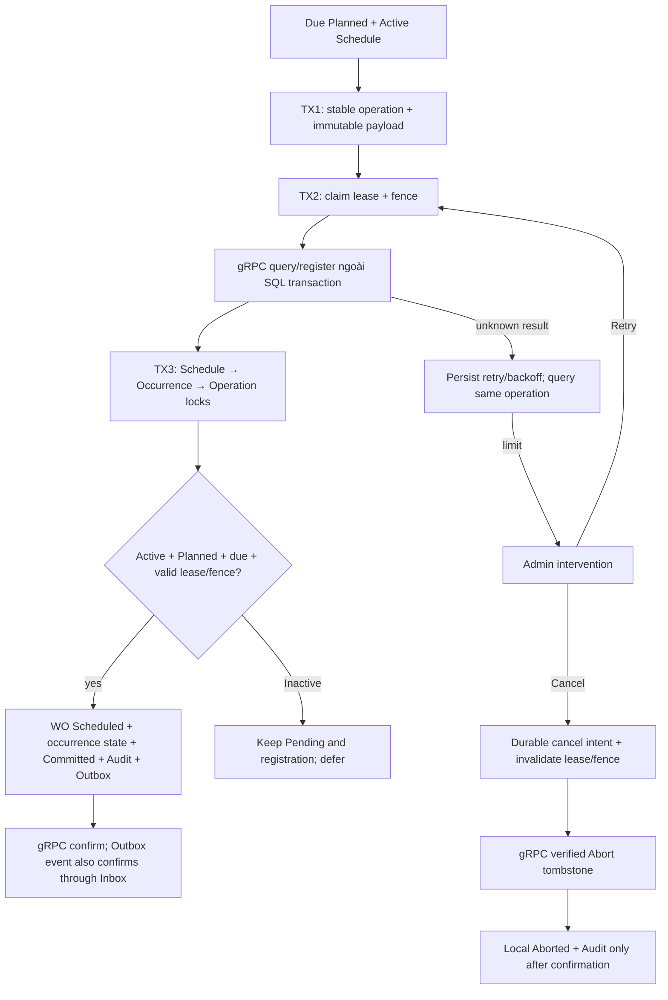

# Module 3 — Stage 0: Re-audit source
Ngày kiểm tra: 05/11/2026. Checkout hiện tại: `D:\PRN232\ASS\MedEquipSLA`; branch `feature/database-code-first`.

## Phạm vi và nguồn quyết định
Yêu cầu người dùng ngày 05/11/2026 “MODULE 3 — WORKORDER GENERATION + EQUIPMENT REGISTRATION + D3 RECONCILIATION + RETIRE” là nguồn phê duyệt Option A, Retire tối thiểu và các điều kiện generation. Hai blocker của audit trước đã được giải quyết. Không cần hỏi lại Option A hoặc phạm vi Retire.

Đã đối chiếu BR-EQP-13..21, D1–D4, C1 và quyết định Module 1/2. Không phát hiện mâu thuẫn nghiệp vụ cần chủ dự án chốt tại Stage 0. Điều kiện Retire cũ vẫn có hiệu lực: chặn mọi registration Pending/Active, gồm Incident và MaintenanceSchedule, không chỉ WorkOrder. Inactive không chứng minh Schedule registration đã được giải phóng. Đây là giới hạn hiện hữu phải giữ trong triển khai, không phải lý do bỏ kiểm tra Schedule.

Báo cáo này mô tả source trước Module 3. Các đề xuất bên dưới chưa phải chức năng đã triển khai.

## File đã kiểm tra và hiện trạng
Các đường dẫn dưới đây tương đối với repository.

| File/path | Kết quả đọc source và khả năng tái sử dụng |
|---|---|
| src/Services/Maintenance/Maintenance.Domain/WorkOrder.cs | Có Assign; chưa có factory Scheduled. Có OccurrenceId, snapshot, registration riêng, thời gian, IsBlocking, AggregateVersion và RowVersion. |
| src/Services/Maintenance/Maintenance.Domain/ScheduleOccurrence.cs | Plan lưu thời gian và reminder snapshot. Chưa có transition Planned → WorkOrderCreated. |
| src/Services/Maintenance/Maintenance.Domain/MaintenanceSchedule.cs | PlanNext dùng D2 CompletionWindowMinutes; reactivation giữ kỳ đã lập, dịch cursor kỳ tương lai theo anchor. Không sửa thuật toán trong Module 3. |
| src/Services/Maintenance/Maintenance.Infrastructure/Persistence/Configurations/WorkOrderConfiguration.cs | Unique Code; filtered unique OccurrenceId; local FK Occurrence NoAction; deadline check; RowVersion. Đủ schema cho WO tạo từ occurrence. |
| src/Services/Maintenance/Maintenance.Infrastructure/Persistence/Configurations/ScheduleOccurrenceConfiguration.cs | Unique ScheduleId + ScheduledOccurrenceAtUtc; index State + scheduled time; enum có WorkOrderCreated; FK Schedule NoAction. |
| src/Services/Maintenance/Maintenance.Infrastructure/Persistence/Entities/IdempotencyRequest.cs và Configurations/IdempotencyRequestConfiguration.cs | Begin hiện hardcode CreateMaintenanceSchedule; hash binary(32), state Pending/Committed/Aborted và unique actor/scope/key. Chưa có request snapshot, retry, lease, fence, Abort intent hay intervention. |
| src/Services/Maintenance/Maintenance.Infrastructure/Persistence/ScheduleCommands.cs | Persist Pending trước RPC; commit Schedule/operation/Audit/Outbox local. Update có RowVersion; cập nhật Schedule tạo khóa ghi cùng hàng mà generation phải serialize. Không có auto recovery cho Schedule Pending. |
| src/Services/Maintenance/Maintenance.Infrastructure/Persistence/OccurrencePlanner.cs; OccurrencePlanningOptions.cs; OccurrencePlanningCursor.cs | Bounded planning/catch-up; keyset selection; SQL RowVersion/unique. Worker restart không mất cursor nghiệp vụ đã lưu ở Schedule. |
| src/Services/Maintenance/Maintenance.Infrastructure/Persistence/ReminderPlanner.cs | Recipient lookup ngoài transaction. Local lock Schedule → Occurrence, Reminder/Outbox cùng transaction. Dùng cùng thứ tự khóa cho Module 3. |
| src/Services/Maintenance/Maintenance.Infrastructure/Persistence/WorkOrderReader.cs; WorkOrderAssignment.cs; Maintenance.Api/WorkOrderEndpoints.cs | Có đọc/phân công; không có generation, lifecycle thực thi hay release WO. |
| src/Services/Maintenance/Maintenance.Infrastructure/Workers/MaintenanceScheduler.cs; MaintenanceReminderWorker.cs | Worker lập kỳ và nhắc việc độc lập. Module 3 thêm worker riêng, không viết lại hai worker này. |
| src/Services/Maintenance/Maintenance.Infrastructure/Workers/ScheduleOutboxDispatcher.cs | Claim/lease/publish/retry; hiện whitelist chỉ Schedule/Reminder. Không tự publish WorkOrder event mới nếu chưa mở rộng whitelist và routing. |
| src/Services/Maintenance/Maintenance.Infrastructure/Persistence/Entities/AuditEntry.cs; OutboxMessage.cs | Audit constructor hiện mặc định MaintenanceSchedule; cần factory đúng loại WO/operation và ActorService. Outbox hỗ trợ aggregateType. |
| src/Services/Equipment/Equipment.Domain/EquipmentAsset.cs | Có retirement fields và terminal priority Retired; chưa có Retire transition. Registration WO Scheduled không được gọi ApplyBlockingStatus làm thay đổi trạng thái. |
| src/Services/Equipment/Equipment.Domain/EquipmentUseRegistration.cs | Register luôn Pending; ApplyIncidentVersion chỉ cho Incident. Chưa có WorkOrder confirm/abort/fence/hash. |
| src/Services/Equipment/Equipment.Infrastructure/Persistence/Configurations/EquipmentUseRegistrationConfiguration.cs | Unique source/operation; unique source/type/resource; index equipment/state; NoAction FK. Types/states đã chứa WorkOrder/Aborted. |
| src/Services/Equipment/Equipment.Infrastructure/Persistence/Configurations/EquipmentAssetConfiguration.cs | Check retirement coherence; RowVersion; retirement reason nvarchar(2000). Chưa thay thế cho command validation. |
| src/Contracts/MedEquipSLA.Contracts.Grpc/Protos/equipment.proto | RPC GetServiceInfo/GetEquipment/RegisterIncidentUse/RegisterScheduleUse. Chưa có WorkOrder RPC. |
| src/Services/Equipment/Equipment.Api/Grpc/EquipmentGrpcService.cs | Register khóa Equipment UPDLOCK,HOLDLOCK; Schedule yêu cầu Admin JWT + source key; không dùng được nguyên trạng cho worker. |
| src/Services/Equipment/Equipment.Api/AssetCatalogEndpoints.cs; Program.cs | Có catalog, profile, transfer; chưa có Retire endpoint. Cần reuse nhóm API Equipment và giữ role Admin. |
| src/BuildingBlocks/MedEquipSLA.Hosting/IdentitySessionValidation.cs | JWT được xác minh phiên bằng Identity. Worker cần scheme service riêng, không giả JWT Admin, không làm nới quyền API người dùng. |
| src/Services/Equipment/Equipment.Domain/EquipmentStateProjection.cs; EquipmentStatusHistory.cs | Projection Incident, trạng thái terminal và history đã có. Retire phải giữ lịch sử. |
| src/Services/Equipment/Equipment.Infrastructure/Workers/IncidentLifecycleConsumer.cs | Inbox + registration + projection local; cùng lock hàng Equipment. Không có consumer WO. Không sửa semantics Incident. |
| src/Services/Equipment/Equipment.Infrastructure/Workers/EquipmentOutboxDispatcher.cs | Hiện chỉ publish DepartmentChanged. Retire audit bắt buộc; không thêm event Retire vô chủ. |
| src/Services/Equipment/Equipment.Domain/ReconciliationCheckpoint.cs và configuration | Checkpoint snapshot theo source, không phải operation queue. Không thay thế metadata retry từng operation. |
| src/Services/{Equipment,Maintenance}/*.Infrastructure/Persistence/*DbContext.cs | Ownership riêng; không FK/navigation xuyên DB. |
| src/Services/{Equipment,Maintenance}/*.Infrastructure/DependencyInjection.cs; *.Api/Program.cs | Registration DI, gRPC client, workers và auth integration points. |
| docs/business/BUSINESS-RULES-D1-D4-APPROVED.md; BUSINESS-RULES-v1.0-PROPOSED.md; REVIEW-v1.0.md; docs/BUSINESS-DOCUMENTATION.md | D3 không timeout-release; BR Retire còn yêu cầu Incident/Schedule, phải giữ. |
| docs/architecture/C1-Container.md; docs/assignment-compliance/PRN232-CHECKLIST.md | C1 gRPC Maintenance→Equipment và Redis→Equipment đã cho phép. Một số checklist vẫn ghi scaffold; không dùng chúng làm bằng chứng runtime. |
| docs/database/erd-model.json; services/Equipment.md; services/Maintenance.md; migrations/*.sql | Model được kiểm bằng test ownership chính xác số cột. Thêm cột phải đồng bộ tài liệu/schema tests theo từng service. |

## Migrations thực tế
- Identity: 20261023044348_InitialCreate.
- Equipment: 20261023044354_InitialCreate.
- Maintenance: 20261023044400_InitialCreate; 20261105101458_AddOccurrenceReminderWindow.
- Incident: 20261023044406_InitialCreate; 20261104183808_AddIncidentOperationPhoto.
- Notification: 20261023044411_InitialCreate.

Đã đọc __EFMigrationsHistory của cả năm database ứng dụng bằng sqlcmd trên LocalDB. Cả năm ONLINE, compatibility 160; hiện chỉ có InitialCreate tương ứng. Incident chưa apply AddIncidentOperationPhoto; Maintenance chưa apply AddOccurrenceReminderWindow. Vì vậy schema source mới hơn hai database ứng dụng này, dù fixture regression chạy đầy đủ migrations thành công.

Đọc thống kê Equipment/Maintenance hiện có: Assets=0, Registrations=0, Checkpoints=0; Schedules=0, Occurrences=0, WorkOrders=0, không có idempotency operation. Đây là quan sát tại thời điểm audit, không phải cam kết database sẽ luôn trống. Không sửa InitialCreate, không apply migration hoặc reset database tại Stage 0. Không được lấy kết quả catalog test để nói database ứng dụng đã upgrade.

## Tests đã đọc
- tests/MedEquipSLA.Database.IntegrationTests/SchemaAndMigrationTests.cs — ownership, model/ERD, SQL indexes/checks, migration apply/rollback/reapply.
- TestDatabase.cs — chỉ LocalDB/loopback port 14333, catalog test định danh riêng; cleanup chỉ catalog fixture.
- OccurrencePlannerTests.cs; OccurrencePlanningSafetyTests.cs — Module 1 timing, restart, concurrency, catch-up.
- MaintenanceReminderTests.cs; MaintenanceReminderInboxTests.cs; ReminderWindowMigrationTests.cs — Module 2 timing, concurrency, local rollback, legacy rows.
- RedisReminderTests.cs — Redis thật, Outbox/Inbox/ACK, duplicate, reclaim, failure proxy.
- EquipmentOutboxTests.cs; PersonalNotificationTests.cs; EfPersistenceTests.cs; DevelopmentMigrationTests.cs — regression liên quan.
- tests/check_backend_workflows.py — actual Gateway/HTTP/gRPC/session/recipient API smoke.

Kết quả lịch sử 61/61 của Module 2 chỉ là tham chiếu. Kết quả chạy lại Stage 0 nằm trong STAGE0-REPORT, không phải PASS Module 3.

## Luồng hiện tại

## Luồng đề xuất

## Phần thiếu và kế hoạch Stage 1
1. Định nghĩa bốn RPC work-order và service credential scope riêng.
2. Mở rộng operation có điều kiện cho WorkOrder; giữ CreateMaintenanceSchedule nguyên semantics.
3. Lease/fence source; payload/hash immutable; durable cancel intent trước network để ngăn late commit.
4. Equipment tombstone bằng registration Aborted, kể cả Abort đến trước Register; giữ unique resource để không tái tạo operation cho cùng kỳ.
5. Retire command Admin khóa cùng Equipment row, kiểm tra mọi unresolved registration và local blocking projection.
6. WO Created event có Equipment consumer idempotent xác nhận registration, không đổi operational status khi Scheduled.
7. Migrations upgrade trên catalog có dữ liệu; rollback chỉ migration mới; nullable/default tương thích hàng cũ.
8. Generation/reconciliation workers bounded; audit đúng actor/entity; tests SQL/gRPC thật và full regression.

## Concurrency risks phải kiểm chứng
- Lock source nhất quán Schedule → Occurrence → Operation; claim chỉ Operation rồi kết thúc transaction trước các bước khác.
- Equipment mọi write registration/Retire khóa Equipment → Registration; không gọi source trong SQL transaction.
- RPC deadline không phải kết luận remote rollback.
- Lease hết hạn: kiểm cả hạn tại commit và token; RowVersion riêng không thay fence.
- Cancel cần bền trước khi remote Abort; chỉ tăng fence ở Equipment không ngăn source cũ commit.
- WorkOrder commit thắng Cancel thì Cancel bị từ chối; Cancel intent thắng commit thì generation không thể commit.
- Failed business condition hoặc retry limit vẫn Pending + intervention; không tự Aborted.
- Retire không được nhìn Scheduled WO thành operational blocking; Pending/Active registration vẫn chặn thanh lý.

## Chưa xác minh tại thời điểm audit source
Module 3 runtime, RPC authorization, migrations mới, race Retire/Register, fencing, Admin Cancel, real Redis WO consumer và Docker Compose chưa được chạy. Xem Stage 0 report cho baseline thực tế.
