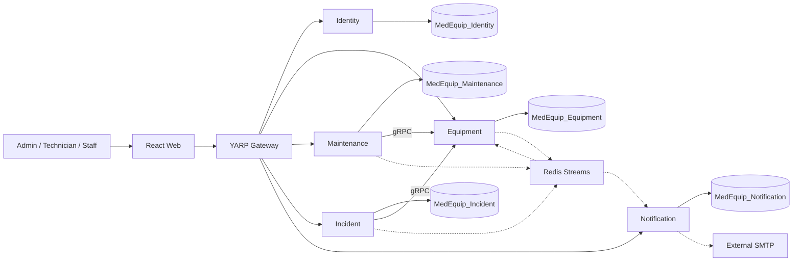

# MedEquipSLA

Hệ thống quản lý thiết bị y tế, bảo trì, hiệu chuẩn, sự cố và SLA theo khoa/phòng, phục vụ đồ án PRN232. Kiến trúc: **5 microservices, SQL Server database per service, EF Core Code First, CQRS và Clean Architecture**.

**Hiện trạng: foundation và database đã triển khai; ứng dụng nghiệp vụ chưa hoàn thiện.** Chạy được API process, Gateway, Swagger, gRPC transport probe và giao diện giới thiệu. Có 5 migration và 47 bảng ứng dụng được kiểm tra trên SQL Server. Đăng nhập, CRUD, department isolation, jobs thực, consumer, email và SignalR còn Planned. Health 200/CI xanh không chứng minh hoàn thành Final Assignment.

## Bắt đầu tại đây

| Nhu cầu | Tài liệu |
|---|---|
| Clone và chạy các thành phần hiện có | [Getting Started](docs/development/GETTING-STARTED.md) |
| Hiểu actor, quy trình, SLA và quyết định còn mở | [Business Documentation](docs/BUSINESS-DOCUMENTATION.md) |
| Xem route/response thật và contract Planned | [API Documentation](docs/API-DOCUMENTATION.md) |
| Hiểu entity, quan hệ, ownership và migrations | [Database Documentation](docs/DATABASE-DOCUMENTATION.md) |
| Tìm toàn bộ tài liệu | [Mục lục docs](docs/README.md) |
| Đối chiếu tiêu chí học phần | [PRN232 Checklist](docs/assignment-compliance/PRN232-CHECKLIST.md) |

## Mục tiêu, vai trò và tính năng

Theo dõi thiết bị theo khoa; xử lý sự cố có nghiệm thu; lưu lịch sử bảo trì/hiệu chuẩn; tính thời gian đáp ứng SLA và gửi thông báo. Không quản lý bệnh nhân, bệnh án hoặc điều trị.

| Vai trò | Phạm vi đích |
|---|---|
| Admin | Tài khoản, khoa, thiết bị, lịch, SLA; phân công và nghiệm thu |
| Technician | Đọc dữ liệu hệ thống, cập nhật công việc được phân công |
| Staff / Department Staff | Xem thiết bị, báo sự cố và xem hồ sơ trong khoa hiện tại |

Role seed là `Admin`, `Technician`, `DepartmentStaff`; policy role/khoa chưa nối vào endpoint nghiệp vụ. Tính năng đích: vòng đời Equipment/Incident/WorkOrder, SLA snapshot 24/7, reminder theo occurrence, registration trước Retire, notification bền và báo cáo theo quyền. [BR v1.0 gốc](docs/business/BUSINESS-RULES-v1.0-PROPOSED.md) vẫn **Proposed**; [ERD v0.1 và D1–D4](docs/database/APPROVAL.md) đã Approved. Không tự nâng toàn bộ BR thành Approved.

## Kiến trúc

Sơ đồ là **kiến trúc đích**; bảng trạng thái phía dưới phân biệt các phần đã chạy.



| Thành phần | Port host | Trách nhiệm / README |
|---|---|---|
| Identity | 5101 | [Tài khoản, JWT, quyền](src/Services/Identity/README.md) |
| Equipment | REST 5102; gRPC 5103 | [Khoa, danh mục, thiết bị, trạng thái](src/Services/Equipment/README.md) |
| Maintenance | 5104 | [Schedule, occurrence, WorkOrder, calibration](src/Services/Maintenance/README.md) |
| Incident | 5105 | [Sự cố, nghiệm thu, SLA](src/Services/Incident/README.md) |
| Notification | 5106 | [Inbox, in-app, email, SignalR](src/Services/Notification/README.md) |
| Gateway / Web | 5100 / 5173 | REST routing / React scaffold |
| SQL Server / Redis | 14333 / 6379 | Infrastructure; host ports bind loopback |

Mỗi service đi theo **API → Application handlers/Services → Repository abstractions → Infrastructure Repository/EF Core → SQL Server**. Domain độc lập framework. Clean Architecture giữ dependency hướng vào trong; CQRS Command/Query nằm ở lớp Application Services, đáp ứng mô hình của đề. Repository theo aggregate, query adapter trả read model; không generic repository hình thức. Không shared entity/DbContext, FK/JOIN/transaction xuyên DB. Xem [C0](docs/architecture/C0-System-Context.md), [C1](docs/architecture/C1-Container.md), [Solution Structure](docs/architecture/SOLUTION-STRUCTURE.md).

## Công nghệ và cấu trúc

| Thành phần | Version khóa trong source |
|---|---|
| .NET SDK / target / ASP.NET & EF Core | 10.0.402 / net10.0 / 10.0.13 |
| SQL Server / Redis | 2022 CU27 compatibility 160 / 8.2.10 |
| gRPC / Protobuf / Redis client | 2.84.0 / 3.36.2 / StackExchange.Redis 3.4.5 |
| YARP / FluentValidation / Swashbuckle | 2.3.0 / 12.2.0 / 10.3.1 |
| Web | Node 24.19.0, React 19.3.0, TypeScript 5.9.3, Vite 7.3.7 |

Nguồn: [global.json](global.json), [Directory.Packages.props](Directory.Packages.props), lockfiles, [package.json](src/Web/package.json), [compose.yaml](compose.yaml). Không tự cập nhật major hoặc dùng image `latest`. Image tag đã khóa; digest/full Docker runtime chưa xác minh.

```text
src/BuildingBlocks/  CQRS interfaces, hosting/JWT/errors
src/Contracts/      Protobuf và IntegrationEvent envelope
src/Gateway/        YARP, không xử lý nghiệp vụ
src/Services/       5 service, mỗi service có Domain/Application/Infrastructure/Api
src/Web/            React/TypeScript
docs/               Nghiệp vụ, API, DB, kiến trúc, phát triển, compliance
scripts/            Apply migrations, kiểm tra database
tests/database/     SQL schema và behavior checks, rollback fixtures
infrastructure/     Bootstrap tạo DB/runtime users
```

## Môi trường, clone và build

Native cần Git, SDK đúng `global.json`, Node 24/npm. PowerShell 7 dùng cho `.ps1`; `sqlcmd` cho SQL checks; `grpcurl` tùy chọn cho gRPC. Docker Desktop/Engine Linux containers + Compose là môi trường chung. Repo hiện Public theo yêu cầu owner; clone/read không cần đăng nhập, push cần quyền collaborator.

```sh
git clone https://github.com/chanqua321/MedEquipSLA.git
cd MedEquipSLA
dotnet tool restore
dotnet restore MedEquipSLA.sln --locked-mode
dotnet build MedEquipSLA.sln -c Release --no-restore
```

Không phụ thuộc LocalDB hoặc đường dẫn máy người tạo. SQL Server container dùng x86-64; thành viên ARM dùng SQL Server x86-64 nhóm/remote với connection riêng. Chưa đo minimum RAM toàn stack. [Environment Setup](docs/development/ENVIRONMENT-SETUP.md) hướng dẫn cấu hình và các chế độ chạy.

## Cấu hình và chạy backend

`appsettings.json` là mẫu, không có password/signing key. `ConnectionStrings__Database` phải đúng owner; `ConnectionStrings__Redis` chọn Redis; Incident/Maintenance dùng `Grpc__EquipmentAddress`. `.env` được Compose đọc, **không tự nạp vào `dotnet run`**. Giữ `Workers__Enabled=false` vì workers hiện chỉ log tick.

Chạy từng lệnh ở terminal riêng, từ root:

```sh
dotnet run --project src/Services/Identity/Identity.Api --launch-profile Identity
dotnet run --project src/Services/Equipment/Equipment.Api --launch-profile Equipment
dotnet run --project src/Services/Maintenance/Maintenance.Api --launch-profile Maintenance
dotnet run --project src/Services/Incident/Incident.Api --launch-profile Incident
dotnet run --project src/Services/Notification/Notification.Api --launch-profile Notification
dotnet run --project src/Gateway/MedEquipSLA.Gateway --launch-profile Gateway
```

Health/Swagger/probe không cần business data; health không kiểm tra SQL/Redis. JWT middleware xác minh RS256/issuer/audience/lifetime qua `Jwt__PublicKeyPath`; chưa có API cấp token, key hoặc user mặc định. Không cấu hình public key thì token không được chấp nhận.

## Frontend và Swagger

```sh
cd src/Web
npm ci
npm run dev
```

Mở http://localhost:5173; đây là trang giới thiệu foundation. `npm run build` kiểm tra TypeScript/build Vite. Proxy frontend `/api/equipment/...` → Gateway `/equipment/...` → Equipment `/...`; health `/api/equipment/health/live`, resource `/api/equipment/api/equipment`.

Swagger trong Development: `http://localhost:<port>/swagger/index.html`, JSON `/swagger/v1/swagger.json` ở port 5101/5102/5104/5105/5106. Gateway không tổng hợp Swagger. Chưa có bearer security definition/Authorize UI; dùng curl/Postman gửi bearer khi có token hợp lệ. [API Documentation](docs/API-DOCUMENTATION.md) ghi route/DTO/status thực tế.

## Docker và migrations

Copy `.env.example` thành `.env` nếu chưa có, điền 6 password mạnh khác nhau. PowerShell: `Copy-Item .env.example .env`; Bash: `cp .env.example .env`. Không ghi đè environment đang dùng.

```sh
docker compose config --quiet
docker compose up -d sqlserver redis db-bootstrap
```

Bootstrap tạo DB/runtime users datareader/datawriter, **không apply schema**. Provision deployment identity trên từng DB và đặt migration connection theo [Database Setup](docs/database/SETUP.md), rồi:

```powershell
pwsh ./scripts/Update-Databases.ps1
docker compose up -d --build
docker compose ps
```

Script mặc định build trước apply; `-NoBuild` chỉ khi đã build Debug. Không tự migrate từ mọi app replica. LocalDB là lựa chọn Windows bổ sung: `pwsh ./scripts/Update-Databases.ps1 -LocalDb`, rồi `pwsh ./scripts/Test-Databases.ps1`. Database đã kiểm chứng trên LocalDB; Compose build/up còn chờ Engine. `docker compose down` giữ volumes; không dùng `down -v` để sửa password.

## Kiểm thử gRPC và Redis Streams

Sau khi Equipment/Incident/Maintenance chạy:

```sh
grpcurl -plaintext -import-path src/Contracts/MedEquipSLA.Contracts.Grpc/Protos -proto equipment.proto -d '{}' localhost:5103 medequip.equipment.v1.EquipmentLookup/GetServiceInfo
curl http://localhost:5105/api/diagnostics/equipment-grpc
curl http://localhost:5104/api/diagnostics/equipment-grpc
docker compose exec redis redis-cli PING
docker compose exec redis redis-cli XLEN medequip:scaffold:v1
```

Probe gRPC thật trả `businessLookupImplemented=false`; GetEquipment cần JWT và còn UNIMPLEMENTED. [gRPC Guide](docs/development/GRPC.md) mô tả lỗi/deadline. [Messaging Guide](docs/development/MESSAGING.md) có XADD/XREADGROUP/ACK kiểm tra Redis. redis-cli không thay producer/consumer app; Outbox/Inbox đã có bảng, xử lý event còn Planned.

## Feature, coding conventions và Git

[Development Workflow](docs/development/DEVELOPMENT-WORKFLOW.md): entity → Fluent API → repository/read adapter → Command/Query/validator → endpoint → migration/test. [Coding Conventions](docs/development/CODING-CONVENTIONS.md): naming, dependencies, UTC, authorization, errors.

Thông thường: cập nhật `main` → `feature/<service>-<scope>` → Conventional Commit → push feature → PR → review/CI → merge. Không force push main, không commit secret/cache. [Git Workflow](docs/development/GIT-WORKFLOW.md) có clone/conflict/PR commands. Owner cho phép push trực tiếp main cho lượt hoàn thiện foundation này; các feature tiếp theo vẫn qua review.

[Team Responsibilities](docs/development/TEAM-RESPONSIBILITIES.md) là bảng mẫu chưa có tên hoặc phân công được xác nhận. Điền thành viên/service/trạng thái/evidence thực, không tự bịa đóng góp.

## Trạng thái và kiểm thử

| Phần | Thực tế |
|---|---|
| 25 runtime/library projects + 1 integration test project, layers/DI/config/errors | Implemented foundation |
| 5 DB, 47 bảng ứng dụng + 5 history | Implemented; SQL Server LocalDB đã kiểm chứng |
| Health/Gateway/Swagger/gRPC diagnostic | Implemented transport/scaffold |
| JWT validation / login và refresh | Middleware có / issuance, rotation Planned |
| CRUD/search/filter/sort/page/role/department | Planned; resource GET 401 hoặc 501 |
| Scheduler/SLA/Notification workers | Skeleton, disabled mặc định |
| Outbox/Inbox processing/retry/email/SignalR/E2E | Planned |
| Dockerfiles/Compose | Có cấu hình; Engine runtime còn BLOCKED khi audit |

```sh
dotnet test MedEquipSLA.sln -c Release --no-build
```

Hiện có **1 .NET integration test project**: 5 model cases và 8 SQL Server runtime cases. Runtime cases Skip/BLOCKED nếu thiếu SQLSERVER_TEST_CONNECTION; không coi skip là runtime PASS. [Hướng dẫn EF tests](tests/MedEquipSLA.Database.IntegrationTests/README.md). SQL suites độc lập vẫn ở `tests/database/`. Xem [database finalization audit](docs/database/FINALIZATION-AUDIT.md), [DB evidence](docs/database/VERIFICATION.md), [GitHub Actions](https://github.com/chanqua321/MedEquipSLA/actions). Không dùng badge PASS cố định.

## Troubleshooting

| Triệu chứng | Kiểm tra / xử lý |
|---|---|
| SDK không khớp | `dotnet --info`, cài SDK global.json; không đổi target tùy máy |
| Docker daemon/pipe unavailable | Khởi động Linux Engine; native probe vẫn dùng được; deployment chưa kiểm chứng |
| SQL login failed / thiếu bảng | Env đúng DB, credential đúng; bootstrap không rotate login cũ; apply migration riêng |
| Swagger 404 | Development launch profile/đúng port; Gateway không có Swagger riêng |
| Resource 401 / 501 | JWT guard / handler skeleton; không phải DB bị mất dữ liệu |
| gRPC Unavailable | Equipment cổng 5103 HTTP/2 và client address; cổng REST 5102 không thay gRPC |
| Worker không tạo việc | Chưa triển khai nghiệp vụ; bật switch chỉ log tick |
| Port bị chiếm | Dừng process của mình hoặc đổi config Gateway/gRPC/Web nhất quán |

Luồng demo đích và các quyết định Delete/CRUD, authorization freshness còn mở nằm trong [Business Documentation](docs/BUSINESS-DOCUMENTATION.md).
