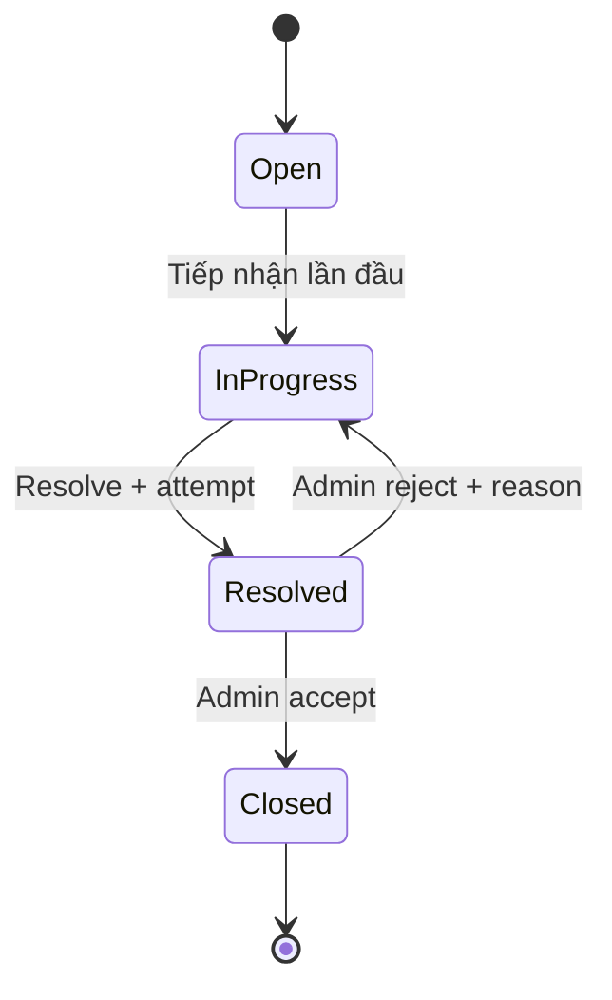
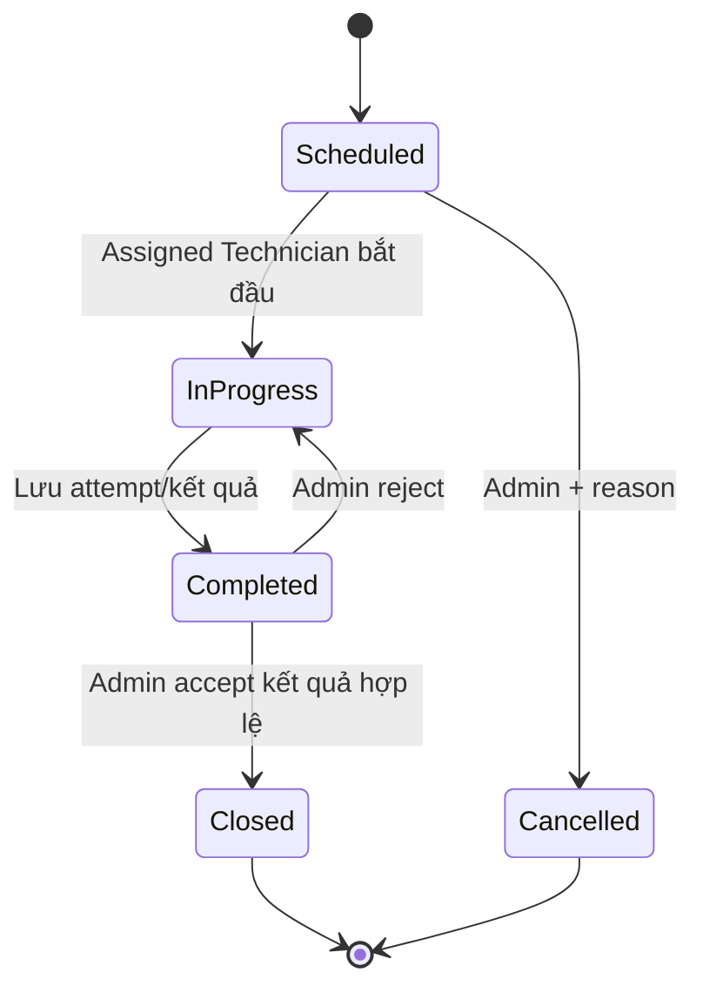
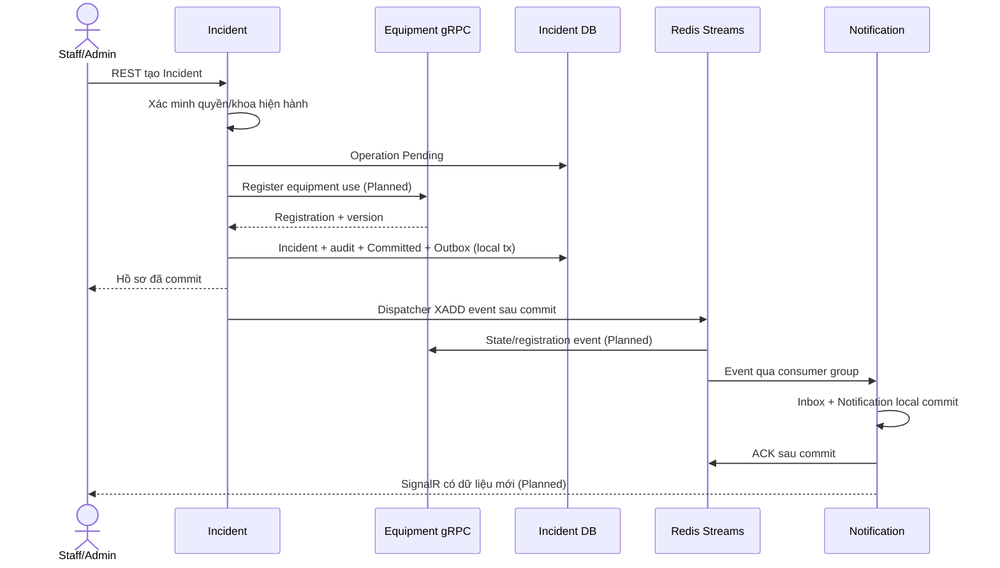

# MedEquipSLA — Tài liệu nghiệp vụ

## 1. Mục tiêu, phạm vi và nguồn yêu cầu

MedEquipSLA giúp cơ sở y tế biết thiết bị thuộc khoa nào, đang hoạt động hay bị chặn bởi sự cố/bảo trì, ai đang xử lý và có đáp ứng SLA hay không. Hệ thống quản lý danh mục, lịch bảo trì/hiệu chuẩn, sự cố, nghiệm thu, thông báo và báo cáo; không quản lý bệnh nhân, bệnh án hoặc điều trị.

Thứ tự nguồn: [đề PRN232](assignment-compliance/PRN232%20-%20Final%20Assignment.pdf) quy định tiêu chí học phần; [BR v1.0 gốc](business/BUSINESS-RULES-v1.0-PROPOSED.md) là **Proposed**; [ERD v0.1/D1–D4](database/APPROVAL.md) đã được người dùng duyệt. [Review](business/REVIEW-v1.0.md) lưu các điểm cần làm rõ, không phải mọi đề xuất trong review đã Approved. Tài liệu này giải thích quy tắc, không tự sửa BR hoặc tuyên bố workflows đã implement.

**Thực tế hiện tại:** đã có schema, migration và constraint tests; luồng nghiệp vụ bên dưới còn Planned. Các entity là persistence shape có private setters, chưa có factory/domain transitions hoàn chỉnh. Chỉ health/Gateway/Swagger/gRPC probe đã chạy; login, CRUD, jobs, events/email/SignalR và E2E chưa chạy nghiệp vụ.

[Phụ lục BR D1–D4 đã duyệt](business/BUSINESS-RULES-D1-D4-APPROVED.md) đồng bộ các điều chỉnh vào bộ BR; D3 protocol vẫn BLOCKED ở phần fencing/abort/snapshot cụ thể.

## 2. Vai trò, khoa và quyền

| Vai trò | Được phép theo nghiệp vụ đích | Giới hạn |
|---|---|---|
| Admin | Tài khoản, khoa, thiết bị, schedule/SLA, phân công, xử lý thay Technician, nghiệm thu | Ghi actor/audit thực tế; không bỏ qua invariant |
| Technician | Xem dữ liệu hệ thống; tiếp nhận/xử lý Incident và WorkOrder được phân công | Không tự tạo Incident hoặc nghiệm thu thay Admin |
| Staff / Department Staff | Xem thiết bị, tạo Incident và xem hồ sơ trong khoa hiện tại | Không xem khoa khác; không tự chọn department để vượt quyền |

Role lưu trong seed là `DepartmentStaff`, không phải chuỗi `Staff`. Notification cá nhân chỉ owner được đọc/mark-read dù thuộc role nào. Quyền đọc báo cáo/KPI của Technician và một số màn hình WorkOrder của Staff cần chốt chi tiết.

Department isolation áp dụng từ backend trước filter/count/page/detail/export. Command cũng kiểm tra scope; không chỉ ẩn nút UI. Equipment giữ DepartmentId hiện hành; Incident/WorkOrder giữ DepartmentId/Name snapshot lúc tạo. Thiết bị chuyển khoa không viết lại lịch sử. Staff hiện tại chỉ thấy lịch sử có snapshot khớp khoa được phép (BR-DEPT-08). Cảnh báo duplicate không được lộ hồ sơ khoa cũ.

Đổi khoa/role hoặc khóa user phải tăng AuthorizationVersion và thu hồi refresh token. Claims cũ không đủ để bảo đảm quyền tức thời. **Chưa chốt/implement** freshness protocol; đề xuất Identity gRPC revalidation nằm trong review. Khi chưa xác minh quyền đáng tin, thao tác nhạy cảm bị từ chối tạm thời, không mặc định cho phép. Không tự mô tả JWT TTL là đã giải quyết thu hồi quyền.

## 3. Equipment lifecycle

Nguồn trạng thái duy nhất là Equipment; Incident/Maintenance không ghi Equipment DB. Thứ tự ưu tiên:

```text
Retired > Broken > UnderMaintenance > Operational
```

- Incident blocking chưa Closed → Broken, kể cả khi đã Resolved chờ nghiệm thu.
- Không có Incident blocking nhưng có WorkOrder blocking InProgress/Completed → UnderMaintenance.
- Không còn blocking và chưa Retired → Operational.
- Scheduled WorkOrder/active Schedule có thể chặn Retire qua registration, nhưng không tự đồng nghĩa UnderMaintenance.
- Retired là trạng thái kết thúc; event muộn không được đưa về Operational.

Projection theo nguồn có version; duplicate/old version không ghi đè mới. Missing version, event gap hoặc snapshot chưa đủ phải dẫn tới retry/đối soát theo contract cần chốt, không tự xóa blocking.

## 4. Incident lifecycle, attempts và tái phát



Assignment là metadata, **không có Assigned status**. Tiếp nhận lần đầu ghi FirstRespondedAtUtc; reassign/reject không xóa mốc này. Resolve cần biên bản/kết quả; server ghi CompletedAtUtc của từng ResolutionAttempt. Reject giữ lần xử lý cũ và lý do. Admin chỉ Close sau nghiệm thu; Closed không Reopen hoặc sửa tiến độ.

Lỗi tái phát tạo Incident mới, có thể RelatedIncidentId cùng EquipmentId. Không sửa hồ sơ cũ. Một thiết bị được có nhiều Incident blocking; đóng một Incident không làm thiết bị Operational nếu còn Incident khác. Duplicate warning khác với unique constraint: Admin có thể xác nhận lỗi độc lập. Cách Staff xác nhận duplicate và quyền thấy hồ sơ liên quan còn phải chốt.

## 5. SLA Policy và cách tính

Priority: Critical/High/Medium/Low. Policy version giữ response/resolution duration và khoảng hiệu lực. Mỗi priority chỉ có một version hiệu lực tại một thời điểm; response >0, resolution ≥response. Không sửa đè version đã dùng hoặc để các khoảng overlap. Schema có check duration/composite key; kiểm tra overlap cần transaction tại Application, chưa implement.

Khi tạo Incident, lấy policy có hiệu lực và snapshot policy ID/version/priority/durations/deadlines:

```text
ResponseDeadlineAtUtc   = CreatedAtUtc + ResponseDurationMinutesSnapshot
ResolutionDeadlineAtUtc = CreatedAtUtc + ResolutionDurationMinutesSnapshot
Response Met           = FirstRespondedAtUtc <= ResponseDeadlineAtUtc
Resolution Met         = CompletedAtUtc của attempt Accepted <= ResolutionDeadlineAtUtc
```

Tính liên tục 24/7, không pause vì chờ vật tư/Technician; lưu UTC, UI Asia/Ho_Chi_Minh. Đổi policy hoặc priority hiển thị không tính lại deadline cũ. Timestamp dùng server, không nhận client để lùi thời gian SLA.

**D1 đã duyệt:** deadline 10:00, attempt hoàn tất 09:50 và Admin accept 10:30 → resolution Met. Nếu lần 09:50 bị reject, lần được accept hoàn tất 10:20 → Breached. ReviewedAtUtc/ClosedAtUtc lưu riêng. Có tối đa một Accepted attempt cuối cùng trên Incident, các Pending/Rejected vẫn giữ lịch sử. Scanner quá hạn tạo alert tạm tính; sự tồn tại alert không tự chứng minh final Breached. Kết quả cuối chốt khi Closed, sau đó không đổi.

## 6. Schedule, occurrence và WorkOrder

Schedule xác định Equipment, WorkType Maintenance/Calibration, AnchorAtUtc, IntervalDays, cửa sổ nhắc hạn và ngày kỳ kế tiếp. Lịch dựa vào anchor/kỳ gốc, không cộng chu kỳ từ lúc job thực thi. Schedule inactive không sinh việc mới; không tự hủy WorkOrder đã tạo.

**D2 đã duyệt:** materialize ScheduleOccurrence đủ sớm để nhắc trước hạn (mặc định 1440 phút), tạo reminder/outbox cho occurrence; chỉ tạo WorkOrder khi đến kỳ. Unique `(ScheduleId,ScheduledOccurrenceAtUtc)` và filtered unique WorkOrder.OccurrenceId chống trùng. Manual WorkOrder có OccurrenceId NULL.

`DueAtUtc = ScheduledOccurrenceAtUtc + CompletionWindowMinutes`; mặc định window 0 theo ERD được duyệt, cấu hình không âm và snapshot vào occurrence. Quá DueAtUtc mà chưa có kết quả được chấp nhận là overdue. Catch-up sau downtime theo batch, giữ kỳ gốc. Ngừng lịch xử lý các kỳ tương lai chưa thực hiện có audit; không xóa lịch sử.



**D4 đã duyệt:** calibration Failed không được Close để giải phóng blocking. Admin trả Completed → InProgress, khắc phục và tạo attempt mới; chỉ Passed được nghiệm thu mới Closed. Cancel trực tiếp chỉ Scheduled chưa bắt đầu; đây là giới hạn đã duyệt đối với BR-MNT-21. Hủy việc đã bắt đầu/đóng failed với disposition khác là nhánh mở rộng chưa thiết kế.

Measurement lưu giá trị, đơn vị, ít nhất một threshold min/max; min ≤max và Passed khớp khoảng. WorkOrderAttempt giữ từng lần thực hiện, cost/currency nếu có, review actor/time/reason. Hoàn tất bảo trì không xóa Incident blocking; Broken có ưu tiên cao hơn UnderMaintenance.

## 7. Retire, registration và reconciliation

**D3 đã duyệt về mô hình:** source tạo OperationId/ResourceId ổn định, ghi operation Pending, gọi Equipment đăng ký sử dụng. Register và Retire serialize trên cùng Equipment row tại DB Equipment. Registration Pending/Active chặn Retire; source commit hồ sơ + operation Committed + Outbox trong local transaction. Event sau commit kích hoạt/release registration khi công việc kết thúc hợp lệ.

Nguồn crash trước commit không cho phép tự release theo TTL. Chỉ release sau xác nhận hồ sơ kết thúc hoặc operation Aborted bền, có fencing ngăn commit muộn. Retire chỉ Admin, không còn Incident chưa Closed, WO chưa Closed/Cancelled và lịch còn hiệu lực; đã Retired thì từ chối hồ sơ mới.

Reconciliation đọc snapshot ổn định, pagination/cursor/watermark và tombstone từ source. Không suy ra “đã đóng” từ một trang rỗng hoặc source timeout. Chỉ hoàn tất đối soát khi có snapshot đầy đủ và xử lý được event đồng thời. Equipment lưu checkpoint/state/error/time, không truy vấn DB nguồn.

**Chi tiết fencing/abort, snapshot APIs và điều kiện hoàn tất chưa được chốt bằng proto/test.** Bảng registration/checkpoint không chứng minh race đã được giải quyết. Không có transaction phân tán.

## 8. Luồng nghiệp vụ theo actor

Các bước dưới đây mô tả hành vi đích Planned. Mỗi luồng giữ điều kiện thay thế/lỗi để frontend/backend dùng chung khi viết acceptance tests.

### F1 — Quản lý tài khoản và chuyển khoa

- **Actor / Owner:** Admin / Identity; Equipment xác minh khoa qua gRPC dự kiến.
- **Preconditions:** Admin có quyền hiện hành, khoa nhận active.
- **Trigger:** Tạo/sửa user, đổi khoa/role hoặc khóa tài khoản.
- **Main flow:** kiểm tra quyền/khoa → cập nhật user, tăng AuthorizationVersion khi quyền đổi → revoke refresh → audit cùng transaction.
- **Alternative:** khóa user thay xóa hồ sơ có lịch sử; giữ department snapshot cũ của hồ sơ nghiệp vụ.
- **Exception:** khoa inactive/không tồn tại → từ chối; gRPC/quyền chưa xác minh → lỗi tạm thời.
- **Result:** quyền nguồn tại Identity thay đổi, các lần authorization mới phải theo cơ chế freshness sẽ chốt.
- **Event:** C1 hiện không yêu cầu Identity producer/Outbox; chưa có auth event contract.

### F2 — Tạo/cập nhật/chuyển khoa thiết bị

- **Actor / Owner:** Admin / Equipment.
- **Preconditions:** category/department hợp lệ, khoa nhận active; update đúng rowVersion.
- **Trigger:** Lưu danh mục hoặc hồ sơ thiết bị.
- **Main flow:** validate code/serial và quyền → lưu Equipment/audit → phát yêu cầu event nếu thay đổi liên quan snapshot/current reference.
- **Alternative:** khoa ngừng dùng chuyển Inactive; không xóa khoa/thiết bị có lịch sử.
- **Exception:** code/serial trùng, khoa inactive, stale rowVersion → từ chối tương ứng.
- **Result:** trạng thái/current department do Equipment sở hữu; hồ sơ cũ giữ snapshot.
- **Event:** Equipment status/department change dự kiến; tên/payload chưa chốt.

### F3 — Báo sự cố, kể cả tái phát

- **Actor / Owner:** Staff trong khoa hoặc Admin / Incident; Equipment phụ trách registration.
- **Preconditions:** quyền/khoa đã xác minh, Equipment không Retired, có SLA version hiệu lực.
- **Trigger:** Gửi báo hỏng; khi tái phát cung cấp RelatedIncidentId cùng Equipment.
- **Main flow:** gRPC Equipment/registration → kiểm tra duplicate trong scope → snapshot thiết bị/khoa/SLA → tạo Open + operation/audit/Outbox local → trả hồ sơ mới.
- **Alternative:** Admin xác nhận một lỗi độc lập dù có Incident khác; tái phát tạo hồ sơ mới, không Reopen Closed.
- **Exception:** gRPC timeout, Retired, related khác Equipment, thiếu SLA hoặc duplicate chưa xử lý theo policy → không tự commit hồ sơ không hợp lệ.
- **Result:** Incident mới có deadline cố định; đăng ký sử dụng chặn Retire.
- **Event:** IncidentCreated Planned; state/registration payload chưa chốt.

### F4 — Phân công, xử lý và nghiệm thu Incident

- **Actor / Owner:** Admin phân công/nghiệm thu; Assigned Technician xử lý / Incident.
- **Preconditions:** trạng thái hợp lệ, role/assignment đúng, rowVersion khớp.
- **Trigger:** assign/accept/resolve/review.
- **Main flow:** assign → accept ghi FirstResponded lần đầu → Resolve tạo attempt → Admin accept → Closed, chốt SLA, audit/outbox.
- **Alternative:** reject có reason → InProgress, giữ FirstResponded và attempt cũ; reassign giữ SLA/history.
- **Exception:** Technician khác assignment, chuyển Open→Closed, sửa Closed hoặc stale version → từ chối.
- **Result:** hồ sơ kết thúc chỉ sau nghiệm thu; Equipment recompute theo tất cả blocking còn lại.
- **Event:** IncidentAssigned/Resolved/Closed Planned; reject/reassign/state snapshot contract cần hoàn thiện.

### F5 — Tạo lịch, nhắc hạn và sinh công việc

- **Actor / Owner:** Admin tạo lịch; scheduler kích hoạt / Maintenance.
- **Preconditions:** Equipment dùng được theo policy, registration hợp lệ, schedule active.
- **Trigger:** tạo/sửa lịch; tick scheduler dự kiến mỗi phút.
- **Main flow:** tính kỳ từ anchor → materialize occurrence trước cửa sổ nhắc → reminder+Outbox → đến kỳ tạo duy nhất một WO Scheduled → tiến NextOccurrence.
- **Alternative:** restart/catch-up xử lý batch kỳ bỏ lỡ; inactive không tạo kỳ mới; giữ WO đã tạo.
- **Exception:** unique key conflict giữa workers → đọc kết quả đã có; dependency/registration chưa xác minh → không giả định hợp lệ.
- **Result:** nhắc trước WO và không có hai WO cho cùng kỳ.
- **Event:** MaintenanceDueSoon/Overdue Planned; reminder bền không nghĩa email đã gửi.

### F6 — Thực hiện và nghiệm thu WorkOrder/calibration

- **Actor / Owner:** Assigned Technician hoặc Admin thực hiện; Admin nghiệm thu / Maintenance.
- **Preconditions:** Scheduled/InProgress hợp lệ, version/quyền đúng.
- **Trigger:** start/complete/review/cancel.
- **Main flow:** start → lưu attempt/measurements → Completed → Admin accept kết quả hợp lệ → Closed; cập nhật blocking/outbox.
- **Alternative:** reject → InProgress; calibration Failed giữ blocking cho đến Passed được nghiệm thu; Cancel chỉ Scheduled kèm reason.
- **Exception:** thiếu kết quả/measurement, threshold sai, Close Failed hoặc Cancel việc đã bắt đầu → từ chối.
- **Result:** attempts/history không bị ghi đè; giải phóng blocking chỉ đúng quy tắc.
- **Event:** WorkOrderAssigned/Completed và state change Planned; started/closed/cancelled contract chưa có typed payload.

### F7 — Retire thiết bị

- **Actor / Owner:** Admin / Equipment.
- **Preconditions:** không còn registrations Pending/Active, Incident/WO/lịch còn hiệu lực đã kết thúc hợp lệ.
- **Trigger:** yêu cầu Retire với version và lý do.
- **Main flow:** kiểm tra quyền → serialize cùng row với Register → kiểm tra local coordination đáng tin → Retired/audit/Outbox.
- **Alternative:** nếu dữ liệu nguồn chưa rõ thì chờ đối soát, không tự mở khóa.
- **Exception:** registration đang hoạt động, stale snapshot/version hoặc nguồn unavailable → từ chối/chờ xác minh.
- **Result:** terminal Retired; Register mới bị chặn, event muộn không hồi sinh thiết bị.
- **Event:** Equipment lifecycle change Planned, tên/payload cần chốt.

### F8 — Quét SLA

- **Actor / Owner:** Background scanner / Incident.
- **Preconditions:** Incident chưa Closed, deadline snapshot và dữ liệu xử lý hiện hành.
- **Trigger:** tick dự kiến mỗi phút.
- **Main flow:** kiểm tra deadline → lưu một alert/Incident/AlertKind + Outbox cùng transaction → log EventId/correlation.
- **Alternative:** concurrent/restarted worker gặp unique key thì không phát thêm alert nghiệp vụ.
- **Exception:** SQL lỗi rollback; Redis lỗi sau commit giữ Outbox để dispatcher retry.
- **Result:** cảnh báo tạm tính bền, final outcome theo D1 khi nghiệm thu.
- **Event:** SlaResponseBreached/SlaResolutionBreached theo tên BR, payload phải phân biệt provisional/final.

### F9 — Nhận thông báo và gửi email

- **Actor / Owner:** Consumer/worker và người nhận / Notification.
- **Preconditions:** event hợp lệ/versioned, xác định được recipient và scope hiện hành.
- **Trigger:** event Redis; user mở danh sách hoặc mark-read; email queue có việc.
- **Main flow:** dedupe Inbox → commit Notification + EmailDelivery nếu cần → ACK → SignalR báo có dữ liệu mới → REST lấy theo quyền; email worker lease/send/log attempt.
- **Alternative:** reconnect tải lại REST; transient SMTP retry hữu hạn; message trùng không tạo lại notification.
- **Exception:** SQL chưa commit thì không ACK; poison event vào retry/DLQ theo policy sẽ chốt; SMTP outcome không chắc chắn lưu attempt Unknown, không hứa exactly-once.
- **Result:** thông báo quan trọng không mất khi realtime/email lỗi; Sent chỉ khi có xác nhận gửi phù hợp.
- **Event:** Notification hiện chưa là producer integration event trong C1; SignalR không phải event broker.

### F10 — Outbox/Inbox và đối soát khi mất kết nối

- **Actor / Owner:** Dispatcher/consumer tại owner tương ứng; Equipment đối soát projection.
- **Preconditions:** transaction source đã commit Outbox; consumer group riêng từng service.
- **Trigger:** event mới, broker khôi phục, pending message hoặc kiểm tra gap.
- **Main flow:** lease Outbox → XADD → mark Published sau broker confirm; XREADGROUP → Inbox+consumer data local commit → ACK; version mới cập nhật projection.
- **Alternative:** duplicate/old version bỏ tác động lặp; source snapshot đầy đủ bổ sung trạng thái bị thiếu.
- **Exception:** crash sau publish trước mark có thể phát lại; unknown/malformed version cần retry/DLQ; snapshot chưa đủ không xóa blocking.
- **Result:** ít nhất một lần truyền, hiệu ứng nghiệp vụ idempotent, trạng thái có khả năng đối soát.
- **Event:** dùng envelope hiện có; typed payload/stream/group/retry policies Planned.

## 9. Luồng đồng bộ và bất đồng bộ

Sơ đồ là thiết kế đích, chưa phải E2E đã chạy:



Lookup đơn thuần không khóa race Retire; register cần protocol D3. Không gọi network trong SQL transaction kéo dài nếu có thể tránh. Các contract chưa có code nằm trong [API Documentation](API-DOCUMENTATION.md).

## 10. Lỗi nghiệp vụ và acceptance criteria

| Tình huống | Kết quả đích / BR |
|---|---|
| Staff ngoài khoa / ID guessing | Không trả dữ liệu; scope tại backend, BR-AUTH-01..08 |
| Quyền hiện hành chưa xác minh | Lỗi tạm thời, không fail-open; BR-AUTH-12/13 |
| Equipment Retired / vẫn có registration | Từ chối tạo/Retire tương ứng; BR-EQP-13..21, D3 |
| Policy thiếu/overlap hoặc duration sai | Từ chối, giữ snapshot cũ; BR-SLA-01..09 |
| State transition sai / stale rowVersion | Conflict; không ghi đè người khác; BR-CON-01..05 |
| Calibration Failed chờ khắc phục | Giữ blocking, không Close/Cancel để mở khóa; D4 |
| Redis/SMTP/SignalR lỗi | Giữ dữ liệu bền, retry phù hợp; BR-EVT-01..15, BR-NOTI-05..12 |

BR có AC-01..14: department isolation, đổi khoa, SLA snapshot/response, nhiều Incident blocking, out-of-order, Retired, tái phát, worker idempotency, broker failure, duplicate event, reconnect, concurrency và calibration failed. Đọc nguyên văn trong [BR](business/BUSINESS-RULES-v1.0-PROPOSED.md). Review bổ sung AC-15..24 là **đề xuất acceptance tests**, chưa phải tests đã chạy: SLA nghiệm thu muộn/reject, failed calibration, register-vs-retire/crash, đổi khoa khi SignalR sống, nhắc trước WO, snapshot nhiều trang, checkout sạch và scope search/export.

SQL checks hiện chỉ kiểm chứng các ràng buộc lưu trữ, ví dụ một WO/occurrence, một Accepted attempt, FK, JSON và rowversion. Không dùng chúng để đánh dấu AC luồng nghiệp vụ PASS. [PRN232 checklist](assignment-compliance/PRN232-CHECKLIST.md) và [DB verification](database/VERIFICATION.md) ghi phạm vi evidence.

## 11. Quyết định còn mở trước feature code

1. Authorization freshness/Identity gRPC, service credential và tác động tới request đang chạy/SignalR.
2. Fencing/abort, reconciliation snapshot pagination/watermark, gap handling và bootstrap dữ liệu cũ theo D3.
3. DELETE/CRUD phù hợp yêu cầu đề và giữ lịch sử; không tự xem archive/retire là tương đương.
4. Duplicate Incident của Staff, reassignment acknowledgement, Admin có tự nghiệm thu việc mình làm hay không.
5. KPI/report scope/export, refresh token transport/password policy, recipients/event payload/stream/group/retry policies.

Giữ các điểm này Planned/Needs decision; chỉ triển khai sau khi có contract/acceptance criteria đủ rõ, không đổi D1–D4 đã duyệt trong một PR tài liệu.
