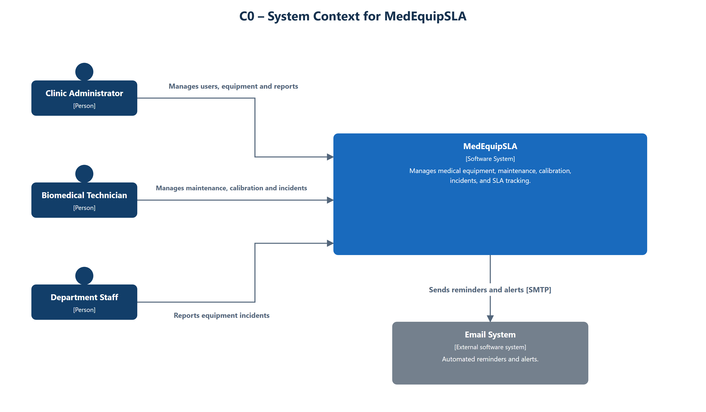
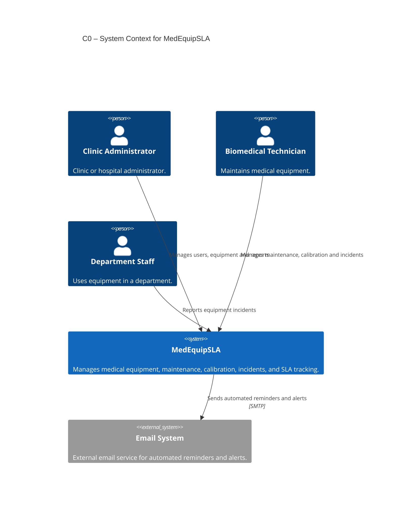

# Level 1 — System Context — MedEquipSLA

> **Diagram type**: System Context
> **Scope**: MedEquipSLA as one software system, the people who use it, and the one external service it depends on.
> **Audience**: Course assignment reviewers and the project team.

## Overview

MedEquipSLA manages medical equipment, maintenance, calibration, incidents, and SLA tracking for a private clinic or hospital.

This diagram shows only outside interaction. The only external service is the Email System, used over SMTP for automated reminders and alerts. The web application, API Gateway, services, Redis Streams, and service-owned databases are inside MedEquipSLA and appear on the Container diagram.

## Diagram

## Legend

- **Person**: a human user of MedEquipSLA
- **Software System**: MedEquipSLA, the one system in scope
- **External system**: the Email System, outside MedEquipSLA
- **SLA**: a deadline for maintenance, calibration, or incident work
- **SMTP**: Simple Mail Transfer Protocol
- Dark blue: people; blue: MedEquipSLA; gray: external Email System.
- Dashed borders are not used. The Email System is external because it is drawn as an external system, not because of a line style

## Elements

| Element | Type | Technology | Responsibility |
|---|---|---|---|
| Clinic Administrator | Person | — | Clinic or hospital administrator. |
| Biomedical Technician | Person | — | Maintains medical equipment. |
| Department Staff | Person | — | Uses equipment in a department. |
| MedEquipSLA | Software System | — *(see Container diagram)* | Manages medical equipment, maintenance, calibration, incidents, and SLA tracking. |
| Email System | External system | SMTP | External email service for automated reminders and alerts. |

## Key relationships

| From | To | Intent | Protocol / Technology |
|---|---|---|---|
| Clinic Administrator | MedEquipSLA | Manages users, equipment and reports | Shown as HTTPS on the Container diagram |
| Biomedical Technician | MedEquipSLA | Manages maintenance, calibration and incidents | Shown as HTTPS on the Container diagram |
| Department Staff | MedEquipSLA | Reports equipment incidents | Shown as HTTPS on the Container diagram |
| MedEquipSLA | Email System | Sends automated reminders and alerts | SMTP |

## Notable architectural decisions

- MedEquipSLA is one software system. Web Application, API Gateway, services, Redis Streams, and SQL Server are not on this diagram.
- The Email System is the only external service.
- In-app notifications stay inside MedEquipSLA. Only automated email leaves the boundary.
- Arrows from the Email System back to each person are omitted. People do not send work by replying to email.

## Assumptions

- No hospital information system, identity provider, or other external service is in scope.
- This is the proposed architecture for the assignment. The system is not implemented yet.

## Links to other levels

- ↓ [Level 2 — Container diagram](./C1-Container.md)
- ↑ [Architecture index](../../README.md)
