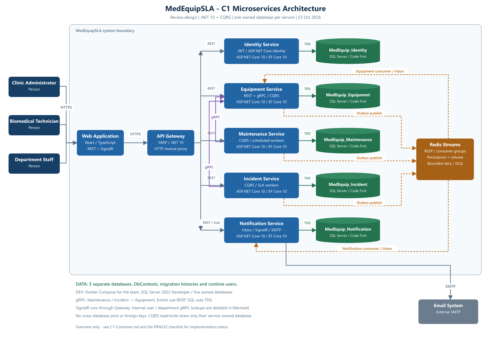
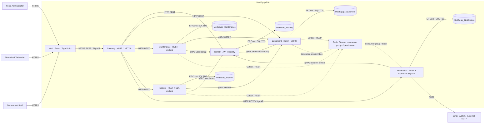

# C1 - Microservices Containers - MedEquipSLA

Ngày cập nhật: 23/10/2026. Kiến trúc đích và trạng thái scaffold/Code First. [Tổng quan](../../README.md).

## Database ownership

| Service | Database sở hữu | Công nghệ |
|---|---|---|
| Identity | MedEquip_Identity | ASP.NET Core 10 / Identity / EF Core 10 Code First |
| Equipment | MedEquip_Equipment | ASP.NET Core 10 / REST + gRPC / EF Core 10 Code First |
| Maintenance & Calibration | MedEquip_Maintenance | ASP.NET Core 10 / workers / EF Core 10 Code First |
| Incident & SLA | MedEquip_Incident | ASP.NET Core 10 / workers / EF Core 10 Code First |
| Notification | MedEquip_Notification | ASP.NET Core 10 / SignalR / EF Core 10 Code First |

Tất cả là SQL Server databases riêng. Baseline nhóm dùng Docker Compose với SQL Server 2022 Developer; không phụ thuộc LocalDB cá nhân. Mỗi service có connection string, runtime user, DbContext và migrations riêng. Không truy cập database service khác. Gateway không có database nghiệp vụ.

## Mermaid source

Mermaid thể hiện đầy đủ gRPC internal lookups. PNG là tổng quan các luồng REST/gRPC/SQL/event chính; gRPC internal lookups được ghi chú để giữ ảnh dễ đọc. SignalR do Web khởi tạo qua Gateway; server push dùng cùng kết nối hai chiều.

## Architectural rules

- Gateway proxy HTTP; nghiệp vụ/CQRS nằm trong từng service. CQRS dùng cùng database cho đọc/ghi trong service.
- Equipment gRPC chạy độc lập với REST API gọi nó ở Maintenance/Incident; REST và gRPC của Equipment có thể host cùng process với endpoint riêng.
- Domain -> Outbox -> Redis Streams -> Inbox -> consumer data. ACK sau commit, bounded retry và dead-letter.
- Equipment sở hữu trạng thái thiết bị; event Incident/Maintenance cập nhật projection cục bộ có aggregate version.
- Notification lưu thông báo bền; SignalR chỉ báo có dữ liệu mới và REST phục hồi khi reconnect.
- Workers nằm trong service sở hữu dữ liệu ở cấu hình nhỏ; JWT và quyền database được kiểm tra tại từng service.

## Trạng thái scaffold và contract

Đây là kiến trúc đích, không phải mọi cạnh đã implement. REST Gateway và Equipment gRPC transport probe đã có source; authentication freshness, lifecycle registration/reconciliation, workers và notifications còn pending. [Compliance Matrix](../assignment-compliance/PRN232-CHECKLIST.md) và [review BR](../business/REVIEW-v1.0.md).

Incident/Maintenance/Equipment/Notification sẽ cần Identity gRPC authorization checks theo BR-AUTH-12. GetServiceInfo là probe development, không chứng minh lookup hoặc phân quyền nghiệp vụ đã hoàn thành.

## Database design proposal

[ERD v0.1 đã được duyệt](../database/ERD-REVIEW.md). Đã sinh/apply Code First migrations cho 5 database và kiểm chứng schema trên SQL Server LocalDB, compatibility 160; baseline Compose của nhóm vẫn là SQL Server 2022. Xem [database verification](../database/VERIFICATION.md). Các protocol/nghiệp vụ mô tả trong C1 vẫn cần được triển khai tại Application/Domain.
