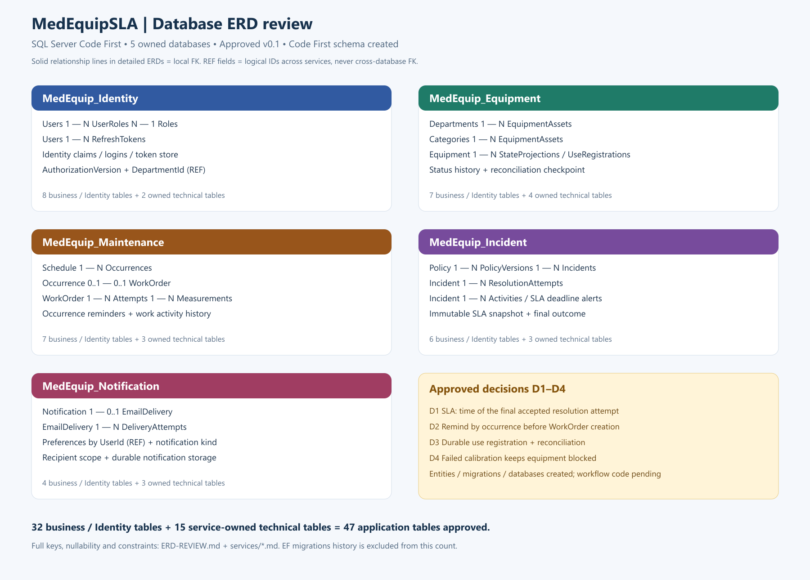

# MedEquipSLA — ERD đã duyệt v0.1

**Phiên bản:** 0.1 — Approved, ngày 23/10/2026. Người dùng đã [duyệt ERD và D1–D4](APPROVAL.md). Entity/DbContext, Fluent API và năm migration InitialCreate đã được tạo; schema thực tế đã đối chiếu với thiết kế. Xem [verification](VERIFICATION.md). Các mô tả luồng bên dưới là quyết định thiết kế đã duyệt, không tuyên bố đã có API/worker thực hiện chúng.

Nguồn: [Business Rules v1.0](../business/BUSINESS-RULES-v1.0-PROPOSED.md), [review nghiệp vụ](../business/REVIEW-v1.0.md), [C0](../architecture/C0-System-Context.md), [C1](../architecture/C1-Container.md), [Compliance Matrix](../assignment-compliance/PRN232-CHECKLIST.md).

## 1. Tổng quan

| Service | Database riêng | Bảng nghiệp vụ / Identity | Bảng kỹ thuật riêng | ERD và chi tiết |
|---|---|---:|---:|---|
| Identity | MedEquip_Identity | 8 | 2 | [ERD + dictionary](./services/Identity.md) / [SVG](./images/Identity-ERD.svg) |
| Equipment | MedEquip_Equipment | 7 | 4 | [ERD + dictionary](./services/Equipment.md) / [SVG](./images/Equipment-ERD.svg) |
| Maintenance | MedEquip_Maintenance | 7 | 3 | [ERD + dictionary](./services/Maintenance.md) / [SVG](./images/Maintenance-ERD.svg) |
| Incident | MedEquip_Incident | 6 | 3 | [ERD + dictionary](./services/Incident.md) / [SVG](./images/Incident-ERD.svg) |
| Notification | MedEquip_Notification | 4 | 3 | [ERD + dictionary](./services/Notification.md) / [SVG](./images/Notification-ERD.svg) |

Tổng **32 bảng nghiệp vụ/Identity + 15 bản sao bảng kỹ thuật do từng service sở hữu = 47 bảng ứng dụng**. Số này gồm 7 bảng chuẩn ASP.NET Core Identity; không phải 47 loại use case hoặc 47 microservices. `__EFMigrationsHistory` mỗi DB không tính vào số trên. CQRS không tạo thêm database đọc/ghi riêng.

[ERD nghiệp vụ tổng hợp năm database — SVG có thể phóng to](./images/ALL-SERVICES-ERD.svg). Nên duyệt từng service để đọc rõ cột. Diagram hiển thị các cột trọng tâm; dictionary của service liệt kê đầy đủ kiểu SQL, nullability và quy tắc/index cần ánh xạ bằng Fluent API. Các bảng kỹ thuật được vẽ riêng tại [Technical ERD](./images/TECHNICAL-TABLES-ERD.svg); mỗi owner có bảng riêng theo ownership matrix, không có shared database.

## 2. Quy tắc đọc và ranh giới dữ liệu

- `PK`: primary key. `FK`: foreign key **trong cùng database**. `UK`: cột tham gia unique index; có thể là khóa ghép/filtered, không có nghĩa mỗi cột đứng riêng đều unique. `REF`: ID tham chiếu service khác, **không tạo FK SQL**.
- `1 — 0..N`: một bản ghi cha có thể chưa có hoặc có nhiều bản ghi con. `0..1` thể hiện quan hệ tùy chọn. Bản ghi con có FK bắt buộc vẫn phải có đúng một cha.
- Guid nghiệp vụ -> `uniqueidentifier`; timestamp -> `datetimeoffset` chuẩn hóa UTC; UI theo Asia/Ho_Chi_Minh. Tiền -> `decimal(18,2)`, measurements -> `decimal(18,6)`.
- `RowVersion` là token concurrency SQL Server sinh. `AggregateVersion` là số nguyên do nghiệp vụ tăng để sắp thứ tự event; hai cột có trách nhiệm khác nhau.
- Mọi FK dùng `DeleteBehavior.NoAction` để giữ lịch sử và tránh multiple cascade paths. Việc xóa entity chưa sử dụng hoặc archive phải đi qua command có kiểm tra, không tự cascade xóa audit/attempts.
- Các enum lưu string có độ dài hữu hạn và check constraint; không nhận trạng thái/ActorId/deadline từ client như dữ liệu có quyền quyết định.

| Cột ngoài database | Nguồn sự thật | Cách dùng |
|---|---|---|
| UserId, TechnicianId, ActorUserId | Identity | Xác minh qua Identity gRPC/authorization; giữ ID lịch sử, không FK sang AspNetUsers |
| DepartmentId tại Identity | Equipment | Kiểm tra khoa active qua gRPC; không nhân bản Department thành entity có quyền ghi |
| EquipmentId tại Maintenance/Incident | Equipment | Lookup + registration theo D3; các trường code/name/khoa được snapshot lúc tạo |
| EquipmentUseRegistrationId tại hồ sơ nguồn | Equipment | ID phối hợp logic; không navigation/FK xuyên DB |
| SourceAggregateId/ResourceId trong projections/notification | Incident/Maintenance/Equipment | Event contract + resolver theo ResourceType; không SQL JOIN xuyên DB |

## 3. Bốn quyết định nghiệp vụ đã được duyệt

### D1 — SLA và lịch sử nghiệm thu

**Đã duyệt:** Resolution SLA dùng `CompletedAtUtc` của `ResolutionAttempt` cuối cùng được Admin chấp nhận. `ReviewedAtUtc`/`ClosedAtUtc` lưu riêng; việc Admin duyệt muộn không tự làm trễ SLA nếu lần xử lý được chấp nhận đã hoàn tất đúng hạn.

Ví dụ deadline 10:00, Resolve 09:50, Admin nghiệm thu đạt 10:30 -> Resolution SLA đạt theo quyết định đã duyệt. Nếu 09:50 bị trả lại và lần sau hoàn tất 10:20 -> trễ. Mỗi attempt giữ riêng; không ghi đè lần Resolve cũ. `SlaDeadlineAlerts` là cảnh báo tạm tính, kết quả cuối được khóa khi Incident Closed. Không lấy sự tồn tại của alert làm bằng chứng final breach.

Nếu bạn muốn tính cả thời gian chờ Admin, đổi policy sang `ClosedAtUtc` trước khi code; cấu trúc attempt vẫn cần để giữ lịch sử.

### D2 — Reminder tồn tại trước WorkOrder

**Đã duyệt:** `MaintenanceSchedule -> ScheduleOccurrence -> WorkOrder`. Job materialize occurrence trong cửa sổ nhắc hạn (mặc định 24 giờ), ghi `OccurrenceReminder` và Outbox; chỉ tạo WorkOrder khi đến kỳ. Unique `(ScheduleId, ScheduledOccurrenceAtUtc)` và unique `WorkOrder.OccurrenceId` ngăn trùng.

`DueAtUtc = ScheduledOccurrenceAtUtc + CompletionWindowMinutes`, window >= 0 và snapshot vào occurrence; mặc định 0 theo bản được duyệt; thay đổi window bằng cấu hình nghiệp vụ có kiểm tra. Overdue khi quá DueAtUtc mà chưa có kết quả được chấp nhận. Ngừng schedule không tự hủy WorkOrder đã sinh; kỳ tương lai chưa thực hiện được Cancelled có audit. Job bắt kịp các kỳ bỏ lỡ theo batch, không đổi lịch gốc.

### D3 — Retire và đối soát

**Đã duyệt:** `EquipmentUseRegistrations` chặn race tạo Incident/Schedule/WorkOrder với Retire, `ReconciliationCheckpoints` theo dõi snapshot đối soát. Hai bảng là metadata do Equipment sở hữu, không phải bản sao database nguồn.

Source ghi operation Pending trước, đăng ký sử dụng thiết bị qua gRPC rồi commit hồ sơ + operation Committed + Outbox. Register và Retire khóa cùng Equipment row trong transaction local. Có registration Pending/Active thì không Retire. Nếu source crash, chỉ release khi đã xác minh hồ sơ kết thúc hoặc operation Aborted bền; source không được commit sau Aborted. Không tự release chỉ vì hết TTL.

Contract fencing/abort và snapshot pagination/watermark phải được chốt, kiểm thử trước khi bật nghiệp vụ này; chỉ có các bảng trên không chứng minh race đã được giải quyết. Không có SQL transaction phân tán.

### D4 — Hiệu chuẩn failed và Cancel

**MVP đã duyệt:** WorkOrder Calibration có kết quả Failed không được Close để giải phóng blocking. Admin trả Completed -> InProgress, sửa lại và lưu attempt mới; chỉ khi kết quả đạt được chấp nhận mới Closed. Cancel trực tiếp chỉ áp dụng Scheduled chưa bắt đầu.

Nếu cần hủy công việc đã bắt đầu hoặc đóng một kết quả Failed để chuyển sang xử lý khác, phải bổ sung disposition/Equipment quality hold được ghi nhận trước khi release blocking. Chưa thêm nhánh này vào MVP; đây là điều chỉnh BR-MNT-21 đã duyệt để không mâu thuẫn BR-MNT-24.

## 4. Các quan hệ chính cần kiểm tra

| Database | Quan hệ | Vì sao |
|---|---|---|
| Identity | Users N—N Roles qua UserRoles; Users 1—N RefreshTokens | RBAC + refresh rotation, không lưu token thô |
| Equipment | Departments/Categories 1—N Equipment; Equipment 1—N projection/registration/history | Nguồn trạng thái duy nhất, nhiều việc blocking đồng thời |
| Maintenance | Schedule 1—N Occurrences; Occurrence 1—0..1 WorkOrder; WorkOrder 1—N Attempts; Attempt 1—N Measurements | Nhắc trước hạn và giữ từng lần làm/nghiệm thu |
| Incident | Policy 1—N Versions; Version 1—N Incidents; Incident 1—N Attempts/Activities/Alerts | Snapshot SLA và hồ sơ bị trả lại không mất lịch sử |
| Notification | Notification 1—0..1 EmailDelivery; Delivery 1—N Attempts | In-app bền, email retry hữu hạn, không hứa exactly-once |

Các điều kiện như “Close cần accepted attempt”, “related Incident cùng thiết bị”, “policy effective intervals không overlap”, “không assign technician inactive” cần application/domain checks và transaction/concurrency, không thể chỉ vẽ FK rồi coi đã bảo đảm.

## 5. Các ràng buộc Code First đáng chú ý

- Không unique trên riêng `Incident.EquipmentId`: một thiết bị được có nhiều Incident blocking. Dedupe cảnh báo khác với cấm tạo lỗi độc lập.
- `(SlaPolicyId, Version)` là PK của policy version và FK ghép tại Incident. Snapshot priority/durations/deadlines vẫn lưu để đáp ứng BR, không tính lại khi đổi Priority hiển thị.
- Unique accepted attempt theo Incident/WorkOrder dùng filtered index; không có FK vòng ngược từ aggregate tới attempt. Các attempt Pending/Rejected vẫn giữ được nhiều bản ghi.
- `SerialNumber`, `WorkOrder.OccurrenceId`, `NormalizedEmail` dùng filtered unique khi khác NULL theo policy; NULL không được diễn giải như giá trị nghiệp vụ trùng.
- Mọi thay đổi quan trọng ghi audit cùng local transaction. Outbox chỉ có tại Equipment/Maintenance/Incident theo producers C1; Inbox tại Equipment/Notification theo consumers. Xem [bảng kỹ thuật](./TECHNICAL-TABLES.md).
- Delete/CRUD: BR cấm hard-delete hồ sơ có lịch sử. Trước khi implement DELETE, cần contract logical archive/retire hoặc chỉ xóa catalog chưa sử dụng, cùng acceptance test. Không tự coi POST Retire là đã chứng minh đủ CRUD của đề.

## 6. Triển khai Code First

1. Chốt ERD cùng D1..D4 và semantics CRUD/Delete; cập nhật BR đề xuất tương ứng.
2. Viết Entity/domain methods, configurations, DbSet và repository/query abstractions riêng từng service. Identity mở rộng bảng chuẩn; Domain không tham chiếu Identity EF.
3. Sinh `InitialCreate` riêng cho 5 DbContext bằng EF Core migrations; review generated SQL, FK/index/check và cascade behavior.
4. Restore/build; kiểm tra migration tạo DB rỗng, nâng schema và RowVersion trên SQL Server thật. Không dùng EF InMemory để kết luận FK/transaction đúng.
5. Apply bằng migration/deployment identity; runtime users không có DDL. Không để mọi replica tự `Database.Migrate()` lúc startup.
6. Seed dữ liệu demo idempotent qua use cases; xác minh DB ownership, không FK/join xuyên database; cập nhật Compliance Matrix bằng evidence thực.

**Trạng thái sau phê duyệt:** đã tạo entity/mapping, migration, SQL script idempotent và database SQL Server thật; các schema/constraint tests có [evidence](VERIFICATION.md). Application handlers, nghiệp vụ đa service và E2E chưa được triển khai. Bootstrap tiếp tục chỉ tạo database/user; bảng ứng dụng do EF migrations sở hữu.

## 7. Nguồn chỉnh sửa

`erd-model.json` là nguồn thiết kế đã duyệt, được đối chiếu với schema thực tế bằng `tests/database/*-Schema.sql`. EF model nằm trong từng service. `services/*.mmd` là Mermaid; `images/*.svg` phóng to được, `images/*.png` dùng xem nhanh. `render.cjs` chỉ vẽ sơ đồ từ JSON, không kết nối SQL hoặc chạy EF. Hướng dẫn renderer nằm đầu file; dependency renderer không thuộc ứng dụng backend/frontend.
