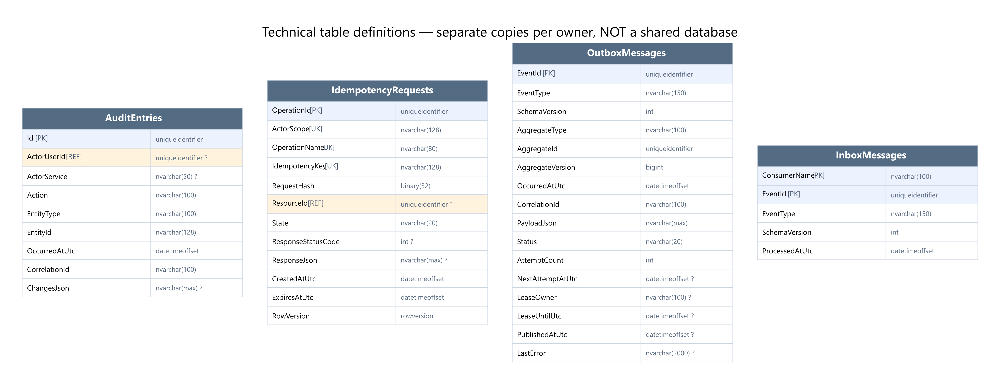

# Bảng kỹ thuật — SQL Server Code First đã duyệt

Mỗi bảng được tạo trong database của service sở hữu. Không có database shared/common. Không tính các bảng kỹ thuật là core CRUD entity của đề PRN232.

| Service | Bảng kỹ thuật dự kiến |
|---|---|
| Identity | AuditEntries, IdempotencyRequests |
| Equipment | AuditEntries, IdempotencyRequests, OutboxMessages, InboxMessages |
| Maintenance | AuditEntries, IdempotencyRequests, OutboxMessages |
| Incident | AuditEntries, IdempotencyRequests, OutboxMessages |
| Notification | AuditEntries, IdempotencyRequests, InboxMessages |

Identity chưa phát auth events trong C1 hiện tại; Notification chưa publish integration event. Vì vậy hai DB này không thêm Outbox không sử dụng. Nếu mở rộng producer/consumer sau, cập nhật C1 và bảng ownership trước.

## AuditEntries

Audit append-only từng database, không gom thành DB dùng chung.

| Cột | SQL type | Khóa | NULL |
|---|---|---|---|
| Id | uniqueidentifier | PK | Không |
| ActorUserId | uniqueidentifier | REF | Có |
| ActorService | nvarchar(50) | — | Có |
| Action | nvarchar(100) | — | Không |
| EntityType | nvarchar(100) | — | Không |
| EntityId | nvarchar(128) | — | Không |
| OccurredAtUtc | datetimeoffset | — | Không |
| CorrelationId | nvarchar(100) | — | Không |
| ChangesJson | nvarchar(max) | — | Có |

- Index(EntityType,EntityId,OccurredAtUtc). ChangesJson IS NULL OR ISJSON=1; không chứa secret. Cùng transaction dữ liệu.

## IdempotencyRequests

Chống request/job lặp và tombstone abort cho phối hợp vòng đời.

| Cột | SQL type | Khóa | NULL |
|---|---|---|---|
| OperationId | uniqueidentifier | PK | Không |
| ActorScope | nvarchar(128) | UK | Không |
| OperationName | nvarchar(80) | UK | Không |
| IdempotencyKey | nvarchar(128) | UK | Không |
| RequestHash | binary(32) | — | Không |
| ResourceId | uniqueidentifier | REF | Có |
| State | nvarchar(20) | — | Không |
| ResponseStatusCode | int | — | Có |
| ResponseJson | nvarchar(max) | — | Có |
| CreatedAtUtc | datetimeoffset | — | Không |
| ExpiresAtUtc | datetimeoffset | — | Không |
| RowVersion | rowversion | — | Không |

- Unique(ActorScope,OperationName,IdempotencyKey); State Pending/Committed/Aborted. ActorScope hỗ trợ user hoặc worker.
- Không xóa Pending hoặc abort tombstone còn có registration/replay chưa đối soát. Sau Aborted, source không được commit muộn.

## OutboxMessages

Sự kiện đã commit, dispatcher publish ít nhất một lần.

| Cột | SQL type | Khóa | NULL |
|---|---|---|---|
| EventId | uniqueidentifier | PK | Không |
| EventType | nvarchar(150) | — | Không |
| SchemaVersion | int | — | Không |
| AggregateType | nvarchar(100) | — | Không |
| AggregateId | uniqueidentifier | — | Không |
| AggregateVersion | bigint | — | Không |
| OccurredAtUtc | datetimeoffset | — | Không |
| CorrelationId | nvarchar(100) | — | Không |
| PayloadJson | nvarchar(max) | — | Không |
| Status | nvarchar(20) | — | Không |
| AttemptCount | int | — | Không |
| NextAttemptAtUtc | datetimeoffset | — | Có |
| LeaseOwner | nvarchar(100) | — | Có |
| LeaseUntilUtc | datetimeoffset | — | Có |
| PublishedAtUtc | datetimeoffset | — | Có |
| LastError | nvarchar(2000) | — | Có |

- ISJSON(PayloadJson)=1; index(Status,NextAttemptAtUtc,OccurredAtUtc). EventId không đổi khi retry.
- Không FK từ AggregateId tới nhiều loại bảng; aggregate + Outbox cùng transaction local.

## InboxMessages

Dedupe consumer cùng transaction local với dữ liệu đã nhận.

| Cột | SQL type | Khóa | NULL |
|---|---|---|---|
| ConsumerName | nvarchar(100) | PK | Không |
| EventId | uniqueidentifier | PK | Không |
| EventType | nvarchar(150) | — | Không |
| SchemaVersion | int | — | Không |
| ProcessedAtUtc | datetimeoffset | — | Không |

- PK(ConsumerName,EventId). Ghi sau xử lý trong cùng transaction, ACK broker sau commit. Không tạo FK sang Outbox ở DB khác.

## Hạ tầng EF

Mỗi database có `__EFMigrationsHistory` do EF Core quản lý. Không vẽ nó như business entity. Không dùng EnsureCreated cùng migrations. `RowVersion` là binary concurrency token SQL Server tự sinh, khác `AggregateVersion` tăng số nguyên cho event ordering.
