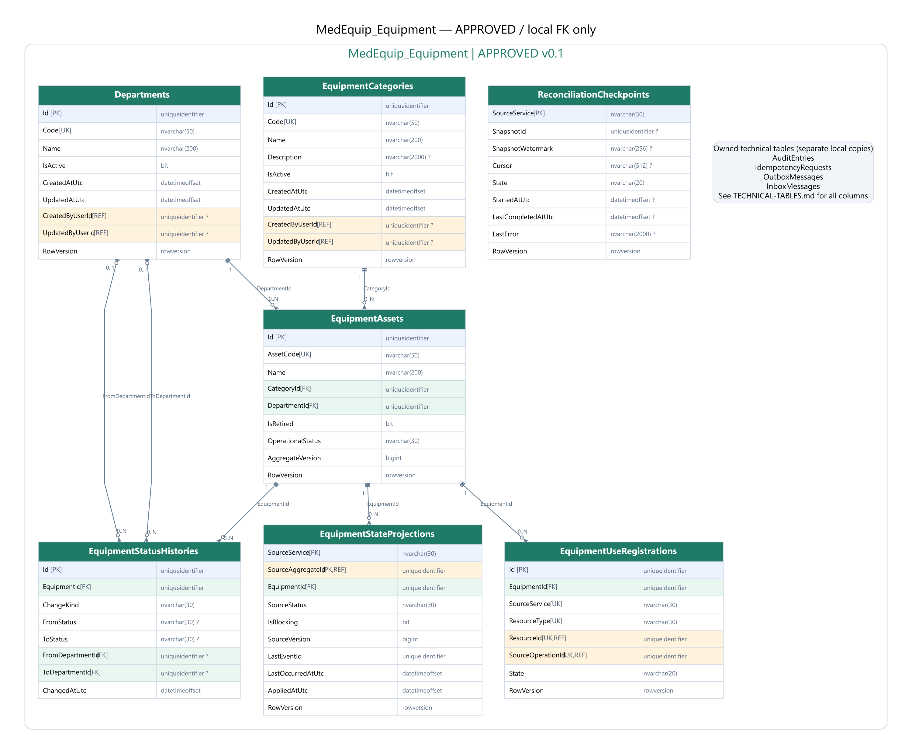
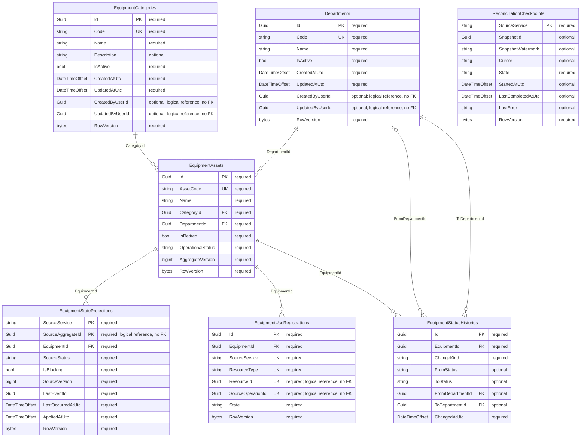

# MedEquip_Equipment — ERD đã duyệt v0.1

**Đã duyệt và tạo schema bằng Code First.** [Tổng quan và quyết định D1–D4](../ERD-REVIEW.md); [kiểm chứng thực tế](../VERIFICATION.md). Use cases/workers còn chờ triển khai.

## Quan hệ

## Data dictionary (SQL Server)

PK = primary key; FK = foreign key trong cùng database; UK = thành phần của một unique constraint/index (xem quy tắc); REF = ID ngoài database, không có FK. NULL cột nào được ghi rõ bên dưới. Diagram chỉ hiện các cột trọng tâm, dictionary là danh sách đầy đủ.

### Departments

Khoa/phòng nguồn, chỉ Equipment sở hữu.

| Cột | SQL type | Khóa | NULL | Ghi chú |
|---|---|---|---|---|
| Id | uniqueidentifier | PK | Không | — |
| Code | nvarchar(50) | UK | Không | — |
| Name | nvarchar(200) | — | Không | — |
| IsActive | bit | — | Không | — |
| CreatedAtUtc | datetimeoffset | — | Không | — |
| UpdatedAtUtc | datetimeoffset | — | Không | — |
| CreatedByUserId | uniqueidentifier | REF | Có | — |
| UpdatedByUserId | uniqueidentifier | REF | Có | — |
| RowVersion | rowversion | — | Không | — |

- Unique Code; không hard-delete nếu có thiết bị/tham chiếu lịch sử. Inactive chặn phân khoa/thiết bị mới.

### EquipmentCategories

Danh mục loại thiết bị.

| Cột | SQL type | Khóa | NULL | Ghi chú |
|---|---|---|---|---|
| Id | uniqueidentifier | PK | Không | — |
| Code | nvarchar(50) | UK | Không | — |
| Name | nvarchar(200) | — | Không | — |
| Description | nvarchar(2000) | — | Có | — |
| IsActive | bit | — | Không | — |
| CreatedAtUtc | datetimeoffset | — | Không | — |
| UpdatedAtUtc | datetimeoffset | — | Không | — |
| CreatedByUserId | uniqueidentifier | REF | Có | — |
| UpdatedByUserId | uniqueidentifier | REF | Có | — |
| RowVersion | rowversion | — | Không | — |

### EquipmentAssets

Thiết bị và trạng thái chính thức; chỉ service này được thay đổi.

| Cột | SQL type | Khóa | NULL | Ghi chú |
|---|---|---|---|---|
| Id | uniqueidentifier | PK | Không | — |
| AssetCode | nvarchar(50) | UK | Không | — |
| SerialNumber | nvarchar(100) | UK | Có | — |
| Name | nvarchar(200) | — | Không | — |
| CategoryId | uniqueidentifier | FK | Không | — |
| DepartmentId | uniqueidentifier | FK | Không | — |
| Manufacturer | nvarchar(200) | — | Có | — |
| Model | nvarchar(100) | — | Có | — |
| PurchasedOn | date | — | Có | — |
| WarrantyUntil | date | — | Có | — |
| IsRetired | bit | — | Không | — |
| OperationalStatus | nvarchar(30) | — | Không | — |
| RetiredAtUtc | datetimeoffset | — | Có | — |
| RetiredByUserId | uniqueidentifier | REF | Có | — |
| RetirementReason | nvarchar(2000) | — | Có | — |
| AggregateVersion | bigint | — | Không | — |
| CreatedAtUtc | datetimeoffset | — | Không | — |
| UpdatedAtUtc | datetimeoffset | — | Không | — |
| CreatedByUserId | uniqueidentifier | REF | Có | — |
| UpdatedByUserId | uniqueidentifier | REF | Có | — |
| RowVersion | rowversion | — | Không | — |

- Unique AssetCode; filtered unique SerialNumber khi khác NULL. Index(DepartmentId,OperationalStatus,Id).
- OperationalStatus ∈ Operational,UnderMaintenance,Broken,Retired; IsRetired phải khớp Retired (check).
- Version >= 1; Retired terminal; trạng thái tính bằng serialized local transaction, không cho client tự set.

### EquipmentStateProjections

Trạng thái các Incident/WorkOrder ảnh hưởng thiết bị, đồng bộ qua event.

| Cột | SQL type | Khóa | NULL | Ghi chú |
|---|---|---|---|---|
| SourceService | nvarchar(30) | PK | Không | — |
| SourceAggregateId | uniqueidentifier | PK,REF | Không | — |
| EquipmentId | uniqueidentifier | FK | Không | — |
| SourceStatus | nvarchar(30) | — | Không | — |
| IsBlocking | bit | — | Không | — |
| SourceVersion | bigint | — | Không | — |
| LastEventId | uniqueidentifier | — | Không | — |
| LastOccurredAtUtc | datetimeoffset | — | Không | — |
| AppliedAtUtc | datetimeoffset | — | Không | — |
| RowVersion | rowversion | — | Không | — |

- PK(SourceService,SourceAggregateId); index(EquipmentId,IsBlocking).
- SourceAggregateId là ID ngoài DB, không phải FK. SourceVersion tăng theo cùng aggregate, event cũ không ghi đè.

### EquipmentUseRegistrations

ĐỀ XUẤT D3: đăng ký sử dụng thiết bị bền để chặn race với Retire.

| Cột | SQL type | Khóa | NULL | Ghi chú |
|---|---|---|---|---|
| Id | uniqueidentifier | PK | Không | — |
| EquipmentId | uniqueidentifier | FK | Không | — |
| SourceService | nvarchar(30) | UK | Không | — |
| ResourceType | nvarchar(30) | UK | Không | — |
| ResourceId | uniqueidentifier | UK,REF | Không | — |
| SourceOperationId | uniqueidentifier | UK,REF | Không | — |
| State | nvarchar(20) | — | Không | — |
| SourceVersion | bigint | — | Không | — |
| RegisteredAtUtc | datetimeoffset | — | Không | — |
| ConfirmedAtUtc | datetimeoffset | — | Có | — |
| ReleasedAtUtc | datetimeoffset | — | Có | — |
| LastVerifiedAtUtc | datetimeoffset | — | Có | — |
| RowVersion | rowversion | — | Không | — |

- Unique(SourceService,ResourceType,ResourceId), unique(SourceService,SourceOperationId).
- State Pending/Active/Released/Aborted. Pending/Active chặn Retire; không tự release theo TTL.
- Register và Retire serialize trên cùng Equipment row; operation abort cần tombstone bền ở service nguồn.

### EquipmentStatusHistories

Lịch sử chuyển trạng thái, retire và chuyển khoa.

| Cột | SQL type | Khóa | NULL | Ghi chú |
|---|---|---|---|---|
| Id | uniqueidentifier | PK | Không | — |
| EquipmentId | uniqueidentifier | FK | Không | — |
| ChangeKind | nvarchar(30) | — | Không | — |
| FromStatus | nvarchar(30) | — | Có | — |
| ToStatus | nvarchar(30) | — | Có | — |
| FromDepartmentId | uniqueidentifier | FK | Có | — |
| ToDepartmentId | uniqueidentifier | FK | Có | — |
| FromDepartmentNameSnapshot | nvarchar(200) | — | Có | — |
| ToDepartmentNameSnapshot | nvarchar(200) | — | Có | — |
| Reason | nvarchar(2000) | — | Có | — |
| ActorUserId | uniqueidentifier | REF | Có | — |
| SourceEventId | uniqueidentifier | — | Có | — |
| ChangedAtUtc | datetimeoffset | — | Không | — |

- Index(EquipmentId,ChangedAtUtc,Id). SourceEventId filtered unique khi khác NULL.
- FK khoa là nội bộ Equipment; giữ snapshots để tên khoa lịch sử không đổi.

### ReconciliationCheckpoints

ĐỀ XUẤT D3: checkpoint đối soát service nguồn; không chứa dữ liệu nghiệp vụ dùng chung.

| Cột | SQL type | Khóa | NULL | Ghi chú |
|---|---|---|---|---|
| SourceService | nvarchar(30) | PK | Không | — |
| SnapshotId | uniqueidentifier | — | Có | — |
| SnapshotWatermark | nvarchar(256) | — | Có | — |
| Cursor | nvarchar(512) | — | Có | — |
| State | nvarchar(20) | — | Không | — |
| StartedAtUtc | datetimeoffset | — | Có | — |
| LastCompletedAtUtc | datetimeoffset | — | Có | — |
| LastError | nvarchar(2000) | — | Có | — |
| RowVersion | rowversion | — | Không | — |

- SourceService chỉ Incident/Maintenance. Không xóa blocking từ snapshot phân trang chưa hoàn tất.

## Bảng kỹ thuật thuộc database này

`AuditEntries`, `IdempotencyRequests`, `OutboxMessages`, `InboxMessages`. Đây là các bảng riêng trong MedEquip_Equipment, không dùng chung instance/table với service khác. [Định nghĩa bảng kỹ thuật](../TECHNICAL-TABLES.md).
