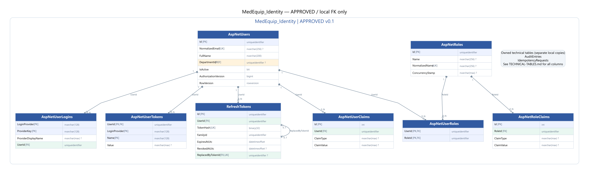
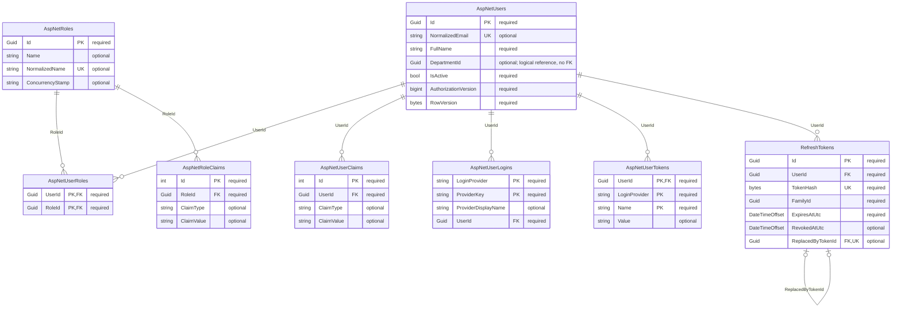

# MedEquip_Identity — ERD đã duyệt v0.1

**Đã duyệt và tạo schema bằng Code First.** [Tổng quan và quyết định D1–D4](../ERD-REVIEW.md); [kiểm chứng thực tế](../VERIFICATION.md). Use cases/workers còn chờ triển khai.

## Quan hệ

## Data dictionary (SQL Server)

PK = primary key; FK = foreign key trong cùng database; UK = thành phần của một unique constraint/index (xem quy tắc); REF = ID ngoài database, không có FK. NULL cột nào được ghi rõ bên dưới. Diagram chỉ hiện các cột trọng tâm, dictionary là danh sách đầy đủ.

### AspNetUsers

Tài khoản nguồn, quyền hiện hành và AuthorizationVersion.

| Cột | SQL type | Khóa | NULL | Ghi chú |
|---|---|---|---|---|
| Id | uniqueidentifier | PK | Không | — |
| UserName | nvarchar(256) | — | Có | — |
| NormalizedUserName | nvarchar(256) | UK | Có | — |
| Email | nvarchar(256) | — | Có | — |
| NormalizedEmail | nvarchar(256) | UK | Có | — |
| EmailConfirmed | bit | — | Không | — |
| PasswordHash | nvarchar(max) | — | Có | — |
| SecurityStamp | nvarchar(max) | — | Có | — |
| ConcurrencyStamp | nvarchar(max) | — | Có | — |
| PhoneNumber | nvarchar(max) | — | Có | — |
| PhoneNumberConfirmed | bit | — | Không | — |
| TwoFactorEnabled | bit | — | Không | — |
| LockoutEnd | datetimeoffset | — | Có | — |
| LockoutEnabled | bit | — | Không | — |
| AccessFailedCount | int | — | Không | — |
| FullName | nvarchar(200) | — | Không | — |
| DepartmentId | uniqueidentifier | REF | Có | Equipment.Department; Staff bắt buộc có khoa active. |
| DepartmentNameSnapshot | nvarchar(200) | — | Có | — |
| IsActive | bit | — | Không | — |
| AuthorizationVersion | bigint | — | Không | — |
| CreatedAtUtc | datetimeoffset | — | Không | — |
| UpdatedAtUtc | datetimeoffset | — | Không | — |
| CreatedByUserId | uniqueidentifier | REF | Có | — |
| UpdatedByUserId | uniqueidentifier | REF | Có | — |
| RowVersion | rowversion | — | Không | — |

- Filtered unique NormalizedUserName và NormalizedEmail khi khác NULL; login email là bắt buộc ở application boundary.
- AuthorizationVersion >= 1; thay role/khoa/IsActive, tăng version và revoke refresh tokens cùng local transaction.

### AspNetRoles

Ba vai trò Admin / Technician / DepartmentStaff.

| Cột | SQL type | Khóa | NULL | Ghi chú |
|---|---|---|---|---|
| Id | uniqueidentifier | PK | Không | — |
| Name | nvarchar(256) | — | Có | — |
| NormalizedName | nvarchar(256) | UK | Có | — |
| ConcurrencyStamp | nvarchar(max) | — | Có | — |

### AspNetUserRoles

Nhiều-nhiều giữa user và role, theo ASP.NET Core Identity.

| Cột | SQL type | Khóa | NULL | Ghi chú |
|---|---|---|---|---|
| UserId | uniqueidentifier | PK,FK | Không | — |
| RoleId | uniqueidentifier | PK,FK | Không | — |

- PK(UserId,RoleId). Ma trận role kết hợp phải được duyệt; quyền resource do application policy kiểm tra.

### AspNetUserClaims

Claims bổ sung của user.

| Cột | SQL type | Khóa | NULL | Ghi chú |
|---|---|---|---|---|
| Id | int | PK | Không | — |
| UserId | uniqueidentifier | FK | Không | — |
| ClaimType | nvarchar(max) | — | Có | — |
| ClaimValue | nvarchar(max) | — | Có | — |

### AspNetRoleClaims

Claims gắn với role.

| Cột | SQL type | Khóa | NULL | Ghi chú |
|---|---|---|---|---|
| Id | int | PK | Không | — |
| RoleId | uniqueidentifier | FK | Không | — |
| ClaimType | nvarchar(max) | — | Có | — |
| ClaimValue | nvarchar(max) | — | Có | — |

### AspNetUserLogins

Bảng chuẩn Identity, dự phòng external-login; không có external provider trong MVP.

| Cột | SQL type | Khóa | NULL | Ghi chú |
|---|---|---|---|---|
| LoginProvider | nvarchar(128) | PK | Không | — |
| ProviderKey | nvarchar(128) | PK | Không | — |
| ProviderDisplayName | nvarchar(max) | — | Có | — |
| UserId | uniqueidentifier | FK | Không | — |

### AspNetUserTokens

Token store chuẩn Identity; không lưu JWT access/refresh token thô.

| Cột | SQL type | Khóa | NULL | Ghi chú |
|---|---|---|---|---|
| UserId | uniqueidentifier | PK,FK | Không | — |
| LoginProvider | nvarchar(128) | PK | Không | — |
| Name | nvarchar(128) | PK | Không | — |
| Value | nvarchar(max) | — | Có | — |

### RefreshTokens

Refresh token hash, rotation và phát hiện reuse theo family.

| Cột | SQL type | Khóa | NULL | Ghi chú |
|---|---|---|---|---|
| Id | uniqueidentifier | PK | Không | — |
| UserId | uniqueidentifier | FK | Không | — |
| TokenHash | binary(32) | UK | Không | — |
| FamilyId | uniqueidentifier | — | Không | — |
| IssuedAtUtc | datetimeoffset | — | Không | — |
| ExpiresAtUtc | datetimeoffset | — | Không | — |
| RevokedAtUtc | datetimeoffset | — | Có | — |
| ReplacedByTokenId | uniqueidentifier | FK,UK | Có | — |
| RevocationReason | nvarchar(200) | — | Có | — |

- Unique TokenHash; index(UserId,FamilyId), (UserId,ExpiresAtUtc).
- Filtered unique ReplacedByTokenId khi khác NULL; một successor chỉ thay thế tối đa một token cũ.
- ExpiresAtUtc > IssuedAtUtc. ReplacedByTokenId khác Id và phải cùng UserId/FamilyId (application).

## Bảng kỹ thuật thuộc database này

`AuditEntries`, `IdempotencyRequests`. Đây là các bảng riêng trong MedEquip_Identity, không dùng chung instance/table với service khác. [Định nghĩa bảng kỹ thuật](../TECHNICAL-TABLES.md).
