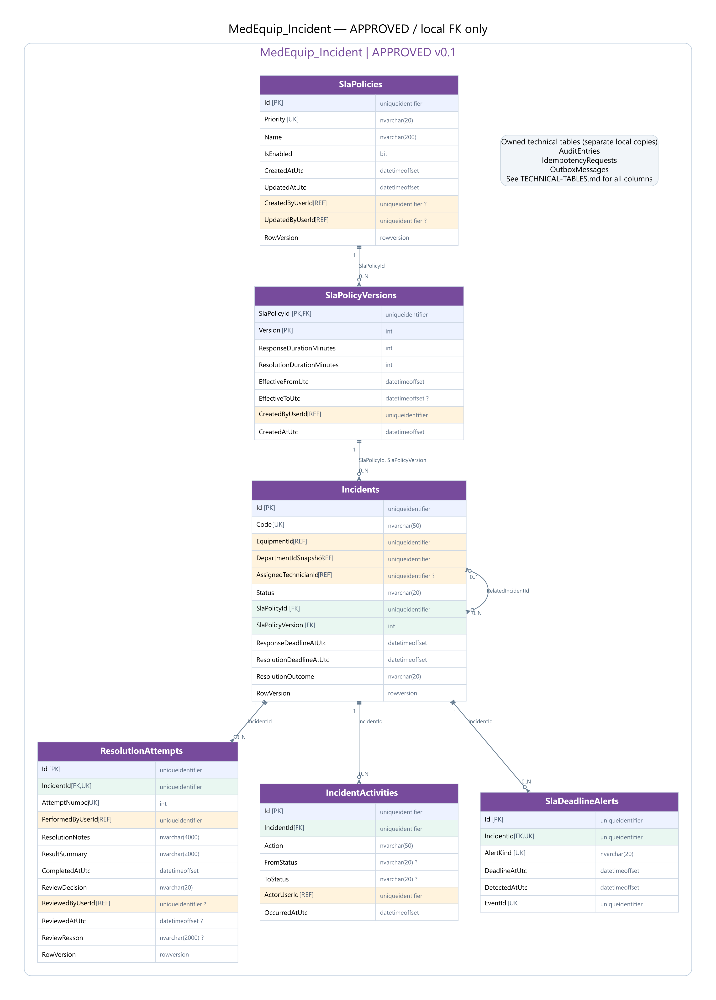
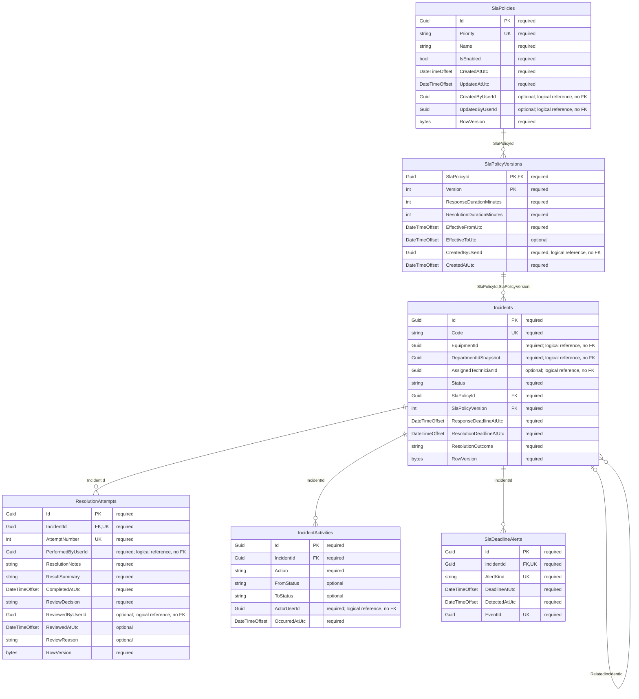

# MedEquip_Incident — ERD đã duyệt v0.1

**Đã duyệt và tạo schema bằng Code First.** [Tổng quan và quyết định D1–D4](../ERD-REVIEW.md); [kiểm chứng thực tế](../VERIFICATION.md). Use cases/workers còn chờ triển khai.

## Quan hệ

## Data dictionary (SQL Server)

PK = primary key; FK = foreign key trong cùng database; UK = thành phần của một unique constraint/index (xem quy tắc); REF = ID ngoài database, không có FK. NULL cột nào được ghi rõ bên dưới. Diagram chỉ hiện các cột trọng tâm, dictionary là danh sách đầy đủ.

### SlaPolicies

Danh mục chính sách theo Priority, không ghi đè version.

| Cột | SQL type | Khóa | NULL | Ghi chú |
|---|---|---|---|---|
| Id | uniqueidentifier | PK | Không | — |
| Priority | nvarchar(20) | UK | Không | — |
| Name | nvarchar(200) | — | Không | — |
| IsEnabled | bit | — | Không | — |
| CreatedAtUtc | datetimeoffset | — | Không | — |
| UpdatedAtUtc | datetimeoffset | — | Không | — |
| CreatedByUserId | uniqueidentifier | REF | Có | — |
| UpdatedByUserId | uniqueidentifier | REF | Có | — |
| RowVersion | rowversion | — | Không | — |

- Priority Critical/High/Medium/Low, unique. IsEnabled không thay cho effective-date logic.

### SlaPolicyVersions

Phiên bản chính sách và khoảng hiệu lực.

| Cột | SQL type | Khóa | NULL | Ghi chú |
|---|---|---|---|---|
| SlaPolicyId | uniqueidentifier | PK,FK | Không | — |
| Version | int | PK | Không | — |
| ResponseDurationMinutes | int | — | Không | — |
| ResolutionDurationMinutes | int | — | Không | — |
| EffectiveFromUtc | datetimeoffset | — | Không | — |
| EffectiveToUtc | datetimeoffset | — | Có | — |
| CreatedByUserId | uniqueidentifier | REF | Không | — |
| CreatedAtUtc | datetimeoffset | — | Không | — |

- PK(SlaPolicyId,Version); unique(SlaPolicyId,EffectiveFromUtc). Durations > 0, resolution >= response, EffectiveTo > EffectiveFrom.
- Không overlap effective intervals theo một policy: application serialize trên SlaPolicy row; CHECK/unique đơn thuần không chứng minh invariant này.
- Không sửa durations của version đã áp dụng; kết thúc interval có audit.

### Incidents

Hồ sơ sự cố, quyền theo snapshot khoa, SLA snapshot và kết quả cuối.

| Cột | SQL type | Khóa | NULL | Ghi chú |
|---|---|---|---|---|
| Id | uniqueidentifier | PK | Không | — |
| Code | nvarchar(50) | UK | Không | — |
| EquipmentId | uniqueidentifier | REF | Không | — |
| EquipmentCodeSnapshot | nvarchar(50) | — | Không | — |
| EquipmentNameSnapshot | nvarchar(200) | — | Không | — |
| DepartmentIdSnapshot | uniqueidentifier | REF | Không | — |
| DepartmentNameSnapshot | nvarchar(200) | — | Không | — |
| Title | nvarchar(200) | — | Không | — |
| Description | nvarchar(4000) | — | Không | — |
| ReportedByUserId | uniqueidentifier | REF | Không | — |
| AssignedTechnicianId | uniqueidentifier | REF | Có | — |
| RelatedIncidentId | uniqueidentifier | FK | Có | — |
| Priority | nvarchar(20) | — | Không | — |
| Status | nvarchar(20) | — | Không | — |
| SlaPolicyId | uniqueidentifier | FK | Không | — |
| SlaPolicyVersion | int | FK | Không | — |
| SlaPrioritySnapshot | nvarchar(20) | — | Không | — |
| ResponseDurationMinutesSnapshot | int | — | Không | — |
| ResolutionDurationMinutesSnapshot | int | — | Không | — |
| CreatedAtUtc | datetimeoffset | — | Không | — |
| ResponseDeadlineAtUtc | datetimeoffset | — | Không | — |
| ResolutionDeadlineAtUtc | datetimeoffset | — | Không | — |
| FirstRespondedAtUtc | datetimeoffset | — | Có | — |
| ClosedAtUtc | datetimeoffset | — | Có | — |
| ResponseOutcome | nvarchar(20) | — | Không | — |
| ResolutionOutcome | nvarchar(20) | — | Không | — |
| SlaFinalizedAtUtc | datetimeoffset | — | Có | — |
| EquipmentUseRegistrationId | uniqueidentifier | REF | Không | — |
| AggregateVersion | bigint | — | Không | — |
| UpdatedAtUtc | datetimeoffset | — | Không | — |
| CreatedByUserId | uniqueidentifier | REF | Không | — |
| UpdatedByUserId | uniqueidentifier | REF | Không | — |
| RowVersion | rowversion | — | Không | — |

- RelatedIncidentId != Id, phải cùng EquipmentId (application). Không hard-delete hoặc reopen Closed.
- Index(DepartmentIdSnapshot,CreatedAtUtc,Id), (Status,ResponseDeadlineAtUtc), (Status,ResolutionDeadlineAtUtc), (AssignedTechnicianId,Status).
- Status Open/InProgress/Resolved/Closed; assignment không đổi Status. Snapshot giữ nguyên khi policy/priority hiển thị thay đổi.
- ĐỀ XUẤT D1: kết quả Resolution dùng CompletedAtUtc của attempt Accepted; ReviewedAtUtc/ClosedAtUtc tách riêng. Outcome cuối chỉ khóa khi Closed.

### ResolutionAttempts

Mỗi lần Resolve và quyết định nghiệm thu; giữ lịch sử bị trả lại.

| Cột | SQL type | Khóa | NULL | Ghi chú |
|---|---|---|---|---|
| Id | uniqueidentifier | PK | Không | — |
| IncidentId | uniqueidentifier | FK,UK | Không | — |
| AttemptNumber | int | UK | Không | — |
| PerformedByUserId | uniqueidentifier | REF | Không | — |
| ResolutionNotes | nvarchar(4000) | — | Không | — |
| ResultSummary | nvarchar(2000) | — | Không | — |
| CompletedAtUtc | datetimeoffset | — | Không | — |
| ReviewDecision | nvarchar(20) | — | Không | — |
| ReviewedByUserId | uniqueidentifier | REF | Có | — |
| ReviewedAtUtc | datetimeoffset | — | Có | — |
| ReviewReason | nvarchar(2000) | — | Có | — |
| RowVersion | rowversion | — | Không | — |

- Unique(IncidentId,AttemptNumber), filtered unique IncidentId WHERE ReviewDecision=Accepted.
- Không cần AcceptedAttemptId FK ngược: accepted attempt xác định bằng unique index, tránh vòng FK. Chỉ Closed khi có một attempt Accepted (application transaction).
- Rejected giữ nguyên CompletedAtUtc và FirstRespondedAtUtc của Incident; backend tạo timestamp.

### IncidentActivities

Timeline trạng thái, phân công lại, đổi priority, review.

| Cột | SQL type | Khóa | NULL | Ghi chú |
|---|---|---|---|---|
| Id | uniqueidentifier | PK | Không | — |
| IncidentId | uniqueidentifier | FK | Không | — |
| Action | nvarchar(50) | — | Không | — |
| FromStatus | nvarchar(20) | — | Có | — |
| ToStatus | nvarchar(20) | — | Có | — |
| FromTechnicianId | uniqueidentifier | REF | Có | — |
| ToTechnicianId | uniqueidentifier | REF | Có | — |
| ActorUserId | uniqueidentifier | REF | Không | — |
| Reason | nvarchar(2000) | — | Có | — |
| OccurredAtUtc | datetimeoffset | — | Không | — |

- Append-only; index(IncidentId,OccurredAtUtc,Id). Ghi cùng transaction thay đổi.

### SlaDeadlineAlerts

Cảnh báo khi quá hạn; không đánh đồng với final SLA outcome.

| Cột | SQL type | Khóa | NULL | Ghi chú |
|---|---|---|---|---|
| Id | uniqueidentifier | PK | Không | — |
| IncidentId | uniqueidentifier | FK,UK | Không | — |
| AlertKind | nvarchar(20) | UK | Không | — |
| DeadlineAtUtc | datetimeoffset | — | Không | — |
| DetectedAtUtc | datetimeoffset | — | Không | — |
| EventId | uniqueidentifier | UK | Không | — |

- Unique(IncidentId,AlertKind), AlertKind Response/Resolution; deadline snapshot bất biến.
- Cảnh báo tạm tính chỉ phát một business EventId/loại; duplicate transport do Inbox xử lý. Final result lấy từ Incident + attempt Accepted, không suy ra chỉ từ tồn tại alert.

## Bảng kỹ thuật thuộc database này

`AuditEntries`, `IdempotencyRequests`, `OutboxMessages`. Đây là các bảng riêng trong MedEquip_Incident, không dùng chung instance/table với service khác. [Định nghĩa bảng kỹ thuật](../TECHNICAL-TABLES.md).
