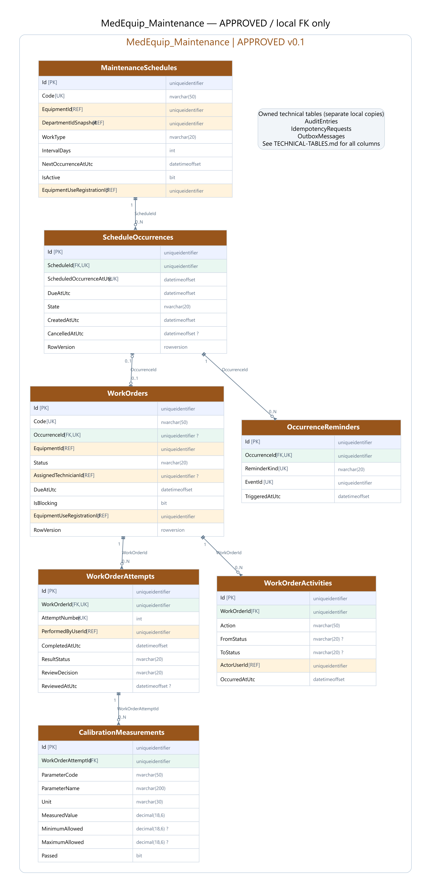
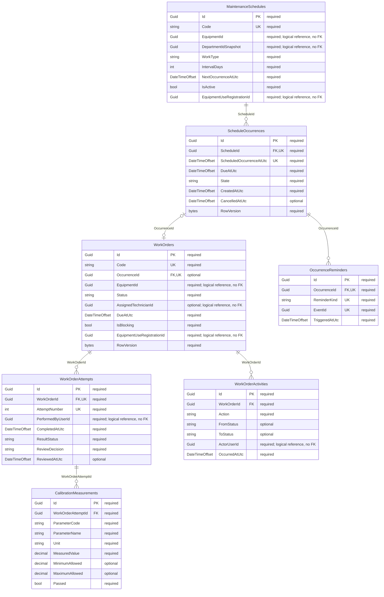

# MedEquip_Maintenance — ERD đã duyệt v0.1

**Đã duyệt và tạo schema bằng Code First.** [Tổng quan và quyết định D1–D4](../ERD-REVIEW.md); [kiểm chứng thực tế](../VERIFICATION.md). Use cases/workers còn chờ triển khai.

## Quan hệ

## Data dictionary (SQL Server)

PK = primary key; FK = foreign key trong cùng database; UK = thành phần của một unique constraint/index (xem quy tắc); REF = ID ngoài database, không có FK. NULL cột nào được ghi rõ bên dưới. Diagram chỉ hiện các cột trọng tâm, dictionary là danh sách đầy đủ.

### MaintenanceSchedules

Lịch định kỳ theo lịch gốc, không trượt theo thời điểm job chạy.

| Cột | SQL type | Khóa | NULL | Ghi chú |
|---|---|---|---|---|
| Id | uniqueidentifier | PK | Không | — |
| Code | nvarchar(50) | UK | Không | — |
| EquipmentId | uniqueidentifier | REF | Không | — |
| EquipmentCodeSnapshot | nvarchar(50) | — | Không | — |
| EquipmentNameSnapshot | nvarchar(200) | — | Không | — |
| DepartmentIdSnapshot | uniqueidentifier | REF | Không | — |
| DepartmentNameSnapshot | nvarchar(200) | — | Không | — |
| WorkType | nvarchar(20) | — | Không | — |
| AnchorAtUtc | datetimeoffset | — | Không | — |
| IntervalDays | int | — | Không | — |
| NextOccurrenceAtUtc | datetimeoffset | — | Không | — |
| ReminderLeadMinutes | int | — | Không | — |
| CompletionWindowMinutes | int | — | Không | — |
| IsActive | bit | — | Không | — |
| EquipmentUseRegistrationId | uniqueidentifier | REF | Không | — |
| AggregateVersion | bigint | — | Không | — |
| CreatedAtUtc | datetimeoffset | — | Không | — |
| UpdatedAtUtc | datetimeoffset | — | Không | — |
| CreatedByUserId | uniqueidentifier | REF | Có | — |
| UpdatedByUserId | uniqueidentifier | REF | Có | — |
| RowVersion | rowversion | — | Không | — |

- IntervalDays > 0; ReminderLeadMinutes >= 0; CompletionWindowMinutes >= 0.
- D2 ĐÃ DUYỆT: sinh occurrence trước ReminderLeadMinutes, tạo WO khi đến kỳ. Mốc overdue = occurrence + CompletionWindowMinutes, mặc định 0 đã duyệt.

### ScheduleOccurrences

D2 ĐÃ DUYỆT: một kỳ cụ thể, có thể tồn tại trước WorkOrder.

| Cột | SQL type | Khóa | NULL | Ghi chú |
|---|---|---|---|---|
| Id | uniqueidentifier | PK | Không | — |
| ScheduleId | uniqueidentifier | FK,UK | Không | — |
| ScheduledOccurrenceAtUtc | datetimeoffset | UK | Không | — |
| DueAtUtc | datetimeoffset | — | Không | — |
| State | nvarchar(20) | — | Không | — |
| CreatedAtUtc | datetimeoffset | — | Không | — |
| CancelledAtUtc | datetimeoffset | — | Có | — |
| RowVersion | rowversion | — | Không | — |

- Unique(ScheduleId,ScheduledOccurrenceAtUtc); DueAtUtc >= ScheduledOccurrenceAtUtc.
- Planned/WorkOrderCreated/Cancelled; không xóa hoặc đổi timestamp kỳ đã có lịch sử.

### WorkOrders

Công việc bảo trì/hiệu chuẩn và nghiệm thu.

| Cột | SQL type | Khóa | NULL | Ghi chú |
|---|---|---|---|---|
| Id | uniqueidentifier | PK | Không | — |
| Code | nvarchar(50) | UK | Không | — |
| OccurrenceId | uniqueidentifier | FK,UK | Có | — |
| EquipmentId | uniqueidentifier | REF | Không | — |
| EquipmentCodeSnapshot | nvarchar(50) | — | Không | — |
| EquipmentNameSnapshot | nvarchar(200) | — | Không | — |
| DepartmentIdSnapshot | uniqueidentifier | REF | Không | — |
| DepartmentNameSnapshot | nvarchar(200) | — | Không | — |
| WorkType | nvarchar(20) | — | Không | — |
| Status | nvarchar(20) | — | Không | — |
| AssignedTechnicianId | uniqueidentifier | REF | Có | — |
| ScheduledForUtc | datetimeoffset | — | Không | — |
| DueAtUtc | datetimeoffset | — | Không | — |
| StartedAtUtc | datetimeoffset | — | Có | — |
| ClosedAtUtc | datetimeoffset | — | Có | — |
| CancelledAtUtc | datetimeoffset | — | Có | — |
| CancellationReason | nvarchar(2000) | — | Có | — |
| IsBlocking | bit | — | Không | — |
| EquipmentUseRegistrationId | uniqueidentifier | REF | Không | — |
| AggregateVersion | bigint | — | Không | — |
| CreatedAtUtc | datetimeoffset | — | Không | — |
| UpdatedAtUtc | datetimeoffset | — | Không | — |
| CreatedByUserId | uniqueidentifier | REF | Có | — |
| UpdatedByUserId | uniqueidentifier | REF | Có | — |
| RowVersion | rowversion | — | Không | — |

- Filtered unique OccurrenceId khi khác NULL; manual WO không có occurrence. Index(Status,DueAtUtc,Id), (AssignedTechnicianId,Status).
- Scheduled -> InProgress -> Completed -> Closed; Completed có thể trả InProgress. Assignment là metadata, không phải Assigned status.
- ĐỀ XUẤT D4: chỉ cancel trực tiếp khi Scheduled; calibration failed không Close/release blocking cho đến rework đạt.

### WorkOrderAttempts

Mỗi lần Completed và quyết định nghiệm thu, không ghi đè kết quả bị trả lại.

| Cột | SQL type | Khóa | NULL | Ghi chú |
|---|---|---|---|---|
| Id | uniqueidentifier | PK | Không | — |
| WorkOrderId | uniqueidentifier | FK,UK | Không | — |
| AttemptNumber | int | UK | Không | — |
| PerformedByUserId | uniqueidentifier | REF | Không | — |
| CompletedAtUtc | datetimeoffset | — | Không | — |
| ResultStatus | nvarchar(20) | — | Không | — |
| Notes | nvarchar(4000) | — | Không | — |
| Cost | decimal(18,2) | — | Có | — |
| CurrencyCode | char(3) | — | Có | — |
| ReviewDecision | nvarchar(20) | — | Không | — |
| ReviewedByUserId | uniqueidentifier | REF | Có | — |
| ReviewedAtUtc | datetimeoffset | — | Có | — |
| ReviewReason | nvarchar(2000) | — | Có | — |
| RowVersion | rowversion | — | Không | — |

- Unique(WorkOrderId,AttemptNumber); filtered unique WorkOrderId WHERE ReviewDecision=Accepted.
- AttemptNumber > 0, Cost >= 0; Review Pending/Accepted/Rejected; accepted/rejected cần actor+time, rejected cần lý do.
- CompletedAtUtc do backend tạo; hiệu chuẩn cần measurements; từng attempt giữ bất biến sau review.

### CalibrationMeasurements

Kết quả đo theo từng lần thực hiện hiệu chuẩn.

| Cột | SQL type | Khóa | NULL | Ghi chú |
|---|---|---|---|---|
| Id | uniqueidentifier | PK | Không | — |
| WorkOrderAttemptId | uniqueidentifier | FK | Không | — |
| ParameterCode | nvarchar(50) | — | Không | — |
| ParameterName | nvarchar(200) | — | Không | — |
| Unit | nvarchar(30) | — | Không | — |
| MeasuredValue | decimal(18,6) | — | Không | — |
| MinimumAllowed | decimal(18,6) | — | Có | — |
| MaximumAllowed | decimal(18,6) | — | Có | — |
| Passed | bit | — | Không | — |

- Unique(WorkOrderAttemptId,ParameterCode). Có ít nhất một ngưỡng; min <= max nếu đủ hai ngưỡng.
- Passed tính bởi backend từ ngưỡng; không cho client tự xác nhận đạt.

### OccurrenceReminders

Nhắc theo kỳ; không phụ thuộc WorkOrder chưa tồn tại.

| Cột | SQL type | Khóa | NULL | Ghi chú |
|---|---|---|---|---|
| Id | uniqueidentifier | PK | Không | — |
| OccurrenceId | uniqueidentifier | FK,UK | Không | — |
| ReminderKind | nvarchar(20) | UK | Không | — |
| EventId | uniqueidentifier | UK | Không | — |
| TriggeredAtUtc | datetimeoffset | — | Không | — |

- Unique(OccurrenceId,ReminderKind); ReminderKind DueSoon/Overdue. Cùng transaction reminder + Outbox, không có EmailSent flag.

### WorkOrderActivities

Audit timeline nghiệp vụ: phân công, bắt đầu, complete, review, cancel.

| Cột | SQL type | Khóa | NULL | Ghi chú |
|---|---|---|---|---|
| Id | uniqueidentifier | PK | Không | — |
| WorkOrderId | uniqueidentifier | FK | Không | — |
| Action | nvarchar(50) | — | Không | — |
| FromStatus | nvarchar(20) | — | Có | — |
| ToStatus | nvarchar(20) | — | Có | — |
| FromTechnicianId | uniqueidentifier | REF | Có | — |
| ToTechnicianId | uniqueidentifier | REF | Có | — |
| ActorUserId | uniqueidentifier | REF | Không | — |
| Reason | nvarchar(2000) | — | Có | — |
| OccurredAtUtc | datetimeoffset | — | Không | — |

- Append-only; index(WorkOrderId,OccurredAtUtc,Id).

## Bảng kỹ thuật thuộc database này

`AuditEntries`, `IdempotencyRequests`, `OutboxMessages`. Đây là các bảng riêng trong MedEquip_Maintenance, không dùng chung instance/table với service khác. [Định nghĩa bảng kỹ thuật](../TECHNICAL-TABLES.md).
