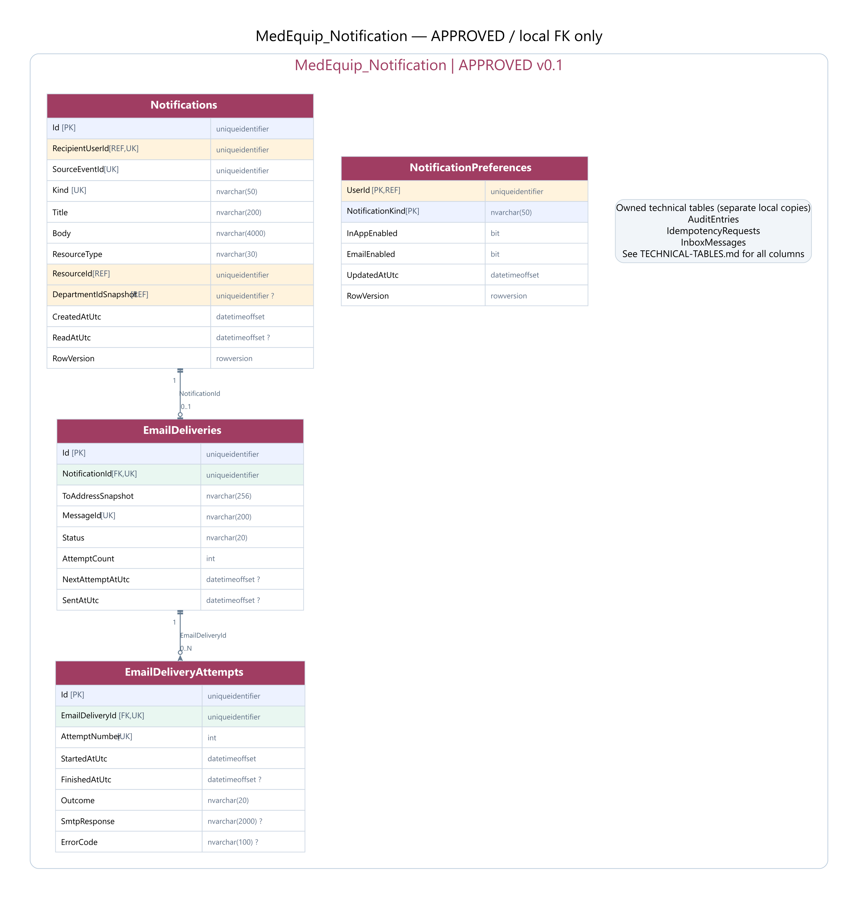
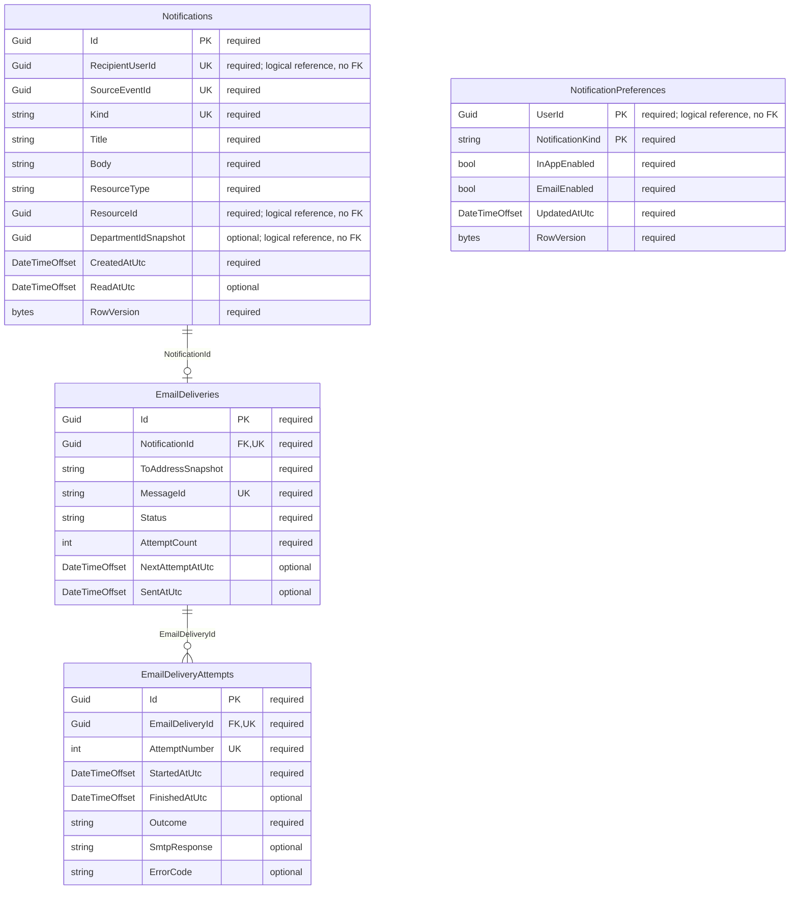

# MedEquip_Notification — ERD đã duyệt v0.1

**Đã duyệt và tạo schema bằng Code First.** [Tổng quan và quyết định D1–D4](../ERD-REVIEW.md); [kiểm chứng thực tế](../VERIFICATION.md). Use cases/workers còn chờ triển khai.

## Quan hệ

## Data dictionary (SQL Server)

PK = primary key; FK = foreign key trong cùng database; UK = thành phần của một unique constraint/index (xem quy tắc); REF = ID ngoài database, không có FK. NULL cột nào được ghi rõ bên dưới. Diagram chỉ hiện các cột trọng tâm, dictionary là danh sách đầy đủ.

### Notifications

Thông báo in-app bền, phạm vi cá nhân và snapshot khoa.

| Cột | SQL type | Khóa | NULL | Ghi chú |
|---|---|---|---|---|
| Id | uniqueidentifier | PK | Không | — |
| RecipientUserId | uniqueidentifier | REF,UK | Không | — |
| SourceEventId | uniqueidentifier | UK | Không | — |
| Kind | nvarchar(50) | UK | Không | — |
| Title | nvarchar(200) | — | Không | — |
| Body | nvarchar(4000) | — | Không | — |
| ResourceType | nvarchar(30) | — | Không | — |
| ResourceId | uniqueidentifier | REF | Không | — |
| DepartmentIdSnapshot | uniqueidentifier | REF | Có | — |
| CreatedAtUtc | datetimeoffset | — | Không | — |
| ReadAtUtc | datetimeoffset | — | Có | — |
| RowVersion | rowversion | — | Không | — |

- Unique(SourceEventId,RecipientUserId,Kind), index(RecipientUserId,ReadAtUtc,CreatedAtUtc,Id).
- JWT sub + quyền khoa hiện hành được kiểm tra ở backend; resource IDs không tạo FK sang service khác.

### NotificationPreferences

Tùy chọn theo người nhận và loại thông báo.

| Cột | SQL type | Khóa | NULL | Ghi chú |
|---|---|---|---|---|
| UserId | uniqueidentifier | PK,REF | Không | — |
| NotificationKind | nvarchar(50) | PK | Không | — |
| InAppEnabled | bit | — | Không | — |
| EmailEnabled | bit | — | Không | — |
| UpdatedAtUtc | datetimeoffset | — | Không | — |
| RowVersion | rowversion | — | Không | — |

- Critical/assignment/SLA policy không được silently drop in-app chỉ vì preference; chính sách bắt buộc do server áp dụng.

### EmailDeliveries

Hàng đợi SMTP có lease/retry; 0 hoặc 1 email cho một notification.

| Cột | SQL type | Khóa | NULL | Ghi chú |
|---|---|---|---|---|
| Id | uniqueidentifier | PK | Không | — |
| NotificationId | uniqueidentifier | FK,UK | Không | — |
| ToAddressSnapshot | nvarchar(256) | — | Không | — |
| Subject | nvarchar(200) | — | Không | — |
| Body | nvarchar(max) | — | Không | — |
| MessageId | nvarchar(200) | UK | Không | — |
| Status | nvarchar(20) | — | Không | — |
| AttemptCount | int | — | Không | — |
| NextAttemptAtUtc | datetimeoffset | — | Có | — |
| LeaseOwner | nvarchar(100) | — | Có | — |
| LeaseUntilUtc | datetimeoffset | — | Có | — |
| CreatedAtUtc | datetimeoffset | — | Không | — |
| SentAtUtc | datetimeoffset | — | Có | — |
| LastError | nvarchar(2000) | — | Có | — |
| RowVersion | rowversion | — | Không | — |

- Unique NotificationId, unique MessageId; index(Status,NextAttemptAtUtc). Status Pending/Processing/Sent/Failed; AttemptCount >= 0.
- Không hứa exactly-once SMTP; cùng MessageId không bảo đảm mọi mail server dedupe.

### EmailDeliveryAttempts

Lịch sử từng lần thử SMTP, không ghi đè lỗi cũ.

| Cột | SQL type | Khóa | NULL | Ghi chú |
|---|---|---|---|---|
| Id | uniqueidentifier | PK | Không | — |
| EmailDeliveryId | uniqueidentifier | FK,UK | Không | — |
| AttemptNumber | int | UK | Không | — |
| StartedAtUtc | datetimeoffset | — | Không | — |
| FinishedAtUtc | datetimeoffset | — | Có | — |
| Outcome | nvarchar(20) | — | Không | — |
| SmtpResponse | nvarchar(2000) | — | Có | — |
| ErrorCode | nvarchar(100) | — | Có | — |

- Unique(EmailDeliveryId,AttemptNumber), AttemptNumber > 0. Không lưu password/credential trong SmtpResponse/error.

## Bảng kỹ thuật thuộc database này

`AuditEntries`, `IdempotencyRequests`, `InboxMessages`. Đây là các bảng riêng trong MedEquip_Notification, không dùng chung instance/table với service khác. [Định nghĩa bảng kỹ thuật](../TECHNICAL-TABLES.md).
